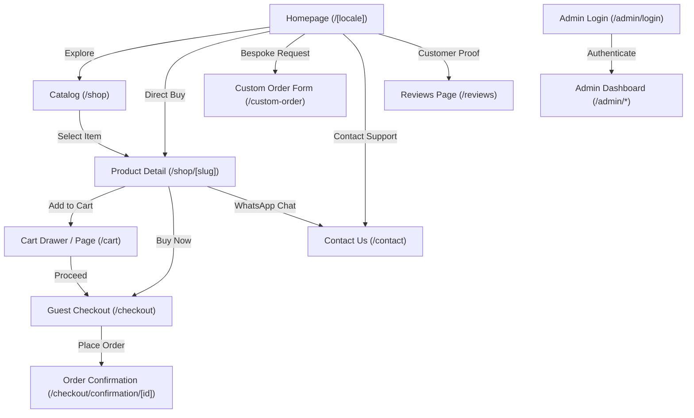
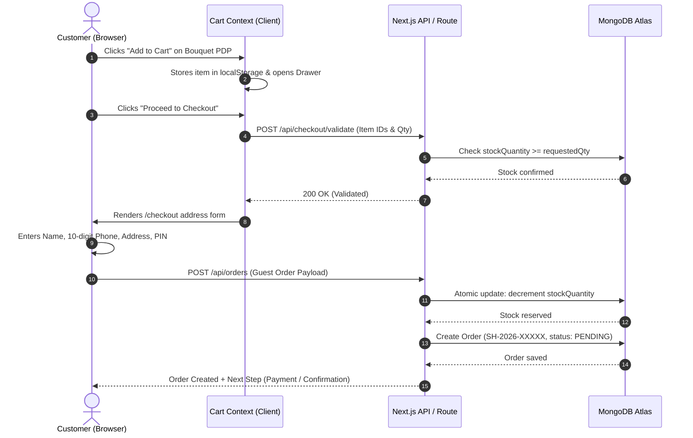
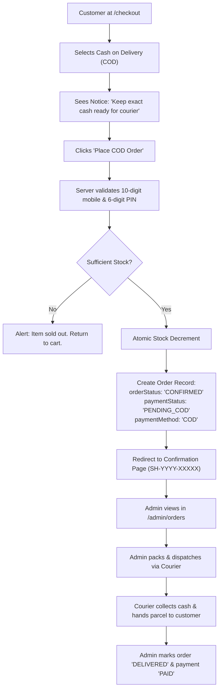
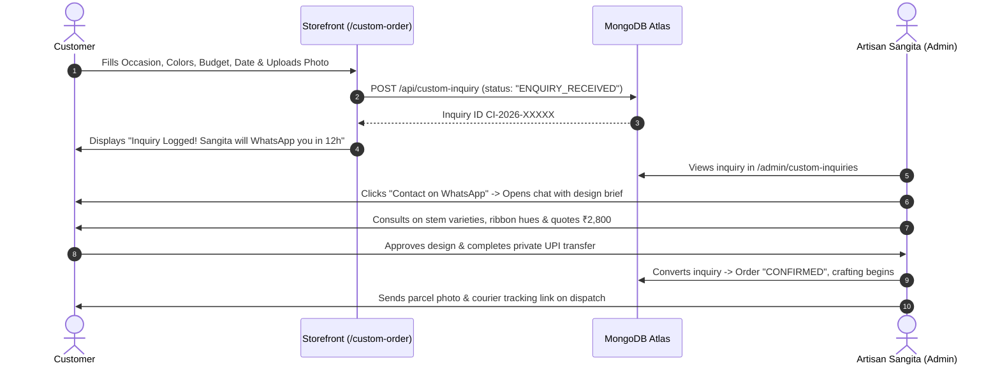
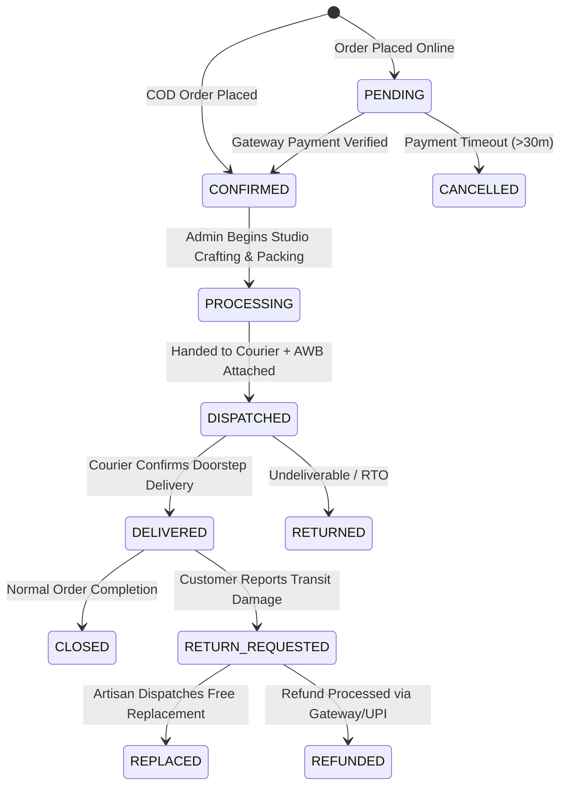

# APPLICATION FLOW DOCUMENT (APP_FLOW)
## Project: Sangita Handmade — Direct-to-Consumer (D2C) E-Commerce Platform

---

| **Document Attribute** | **Specification Details** |
| :--- | :--- |
| **Document Title** | Application Workflow & User Journey Specification (APP_FLOW) |
| **Document Version** | 1.0.0 (Release Baseline) |
| **Date** | October 14, 2026 |
| **Status** | Approved for UX/UI Design & Implementation |
| **Author / Roles** | Senior UX Architect, Product Designer, Full-Stack Workflow Specialist |
| **Companion Documents**| [`PRD.md`](file:///c:/Users/DELL/OneDrive/Documents/sangita%20handmade/PRD.md) (Product Requirements), [`TRD.md`](file:///c:/Users/DELL/OneDrive/Documents/sangita%20handmade/TRD.md) (Technical Requirements) |
| **Target Audience** | UI/UX Designers, Frontend/Backend Developers, Quality Assurance Engineers |

---

## 1. Purpose and Relationship to PRD.md and TRD.md

### 1.1 Purpose of this Document
The **Application Flow Document (APP_FLOW.md)** defines the step-by-step journeys, user interactions, system responses, state transitions, validation checkpoints, and exception-recovery pathways across **Sangita Handmade**. 

While [`PRD.md`](file:///c:/Users/DELL/OneDrive/Documents/sangita%20handmade/PRD.md) specifies *what* business capabilities are required and [`TRD.md`](file:///c:/Users/DELL/OneDrive/Documents/sangita%20handmade/TRD.md) specifies *how* the underlying engineering architecture is structured, this document details the exact *user experience and operational flow*:
- What a user sees on screen.
- What actions they perform (clicks, inputs, filters, submissions).
- How the application validates and processes each action.
- What feedback, confirmations, or error alerts are presented.
- How the system gracefully recovers when a step fails.

### 1.2 Relationship to PRD and TRD
- **Single Source of Business Truth:** Inherits all confirmed business rules, brand colors (`#FFF8EF`, `#722F3E`, `#C6A15B`), product categories (*Flowers, Bouquets, Custom Orders, Gifts, Decor*), and guest checkout constraints from [`PRD.md`](file:///c:/Users/DELL/OneDrive/Documents/sangita%20handmade/PRD.md).
- **Single Source of Technical Truth:** Respects all database models, decoupled order/payment state machines, edge middleware authentication guards, atomic inventory queries, and serverless constraints established in [`TRD.md`](file:///c:/Users/DELL/OneDrive/Documents/sangita%20handmade/TRD.md).
- **No Invented Business Decisions:** Pending decisions (such as the final flat shipping rate, live payment gateway account, and live business contact information) are marked as **Pending Decision** and handled via configurable parameters.

---

## 2. User Roles and Permissions

```
+----------------------------------------------------------------------------------------------------+
| USER ROLES & ACCESS MATRIX                                                                         |
+----------------------------------------------------------------------------------------------------+
| Capability / Route Area           | Guest Customer          | Store Owner / Admin (Sangita)        |
| :-------------------------------- | :---------------------: | :----------------------------------: |
| Browse Catalog & Search Items     | Full Access             | Full Access                          |
| Switch Language (EN / HI)         | Full Access             | Full Access                          |
| Add to Cart & Guest Checkout      | Full Access             | Full Access                          |
| Pay via Gateway / UPI / COD       | Full Access             | Full Access                          |
| Submit Custom Order Inquiry       | Full Access             | Full Access                          |
| Submit Product Review             | Full Access (Moderated) | Full Access                          |
| Access /admin/* Dashboard Pages   | BLOCKED (401/Redirect)  | Authenticated Access                 |
| Access /api/admin/* API Routes    | BLOCKED (401 JSON)      | Authenticated Access                 |
| Product CRUD & Stock Management   | No Access               | Full Admin Controls                  |
| Order Status & Courier Tracking   | No Access               | Full Admin Controls                  |
| Custom Inquiry Review & Quoting   | No Access               | Full Admin Controls                  |
| Review Moderation (Approve/Reject)| No Access               | Full Admin Controls                  |
| Sales Reports & Store Settings    | No Access               | Full Admin Controls                  |
+----------------------------------------------------------------------------------------------------+
```

---

## 3. Sitemap and Page Navigation

```
                                  [ SANGITA HANDMADE SITEMAP ]
                                                |
        +---------------------------------------+---------------------------------------+
        |                                                                               |
[ PUBLIC STOREFRONT (/[locale]) ]                                         [ PROTECTED ADMIN (/admin) ]
        |                                                                               |
        |-- / (Homepage)                                                                |-- /admin/login
        |-- /shop (All Products Catalog)                                                |-- /admin/dashboard
        |     |-- /shop/[slug] (Product Detail Page)                                    |-- /admin/products
        |-- /cart (Full Cart Review)                                                    |     |-- /admin/products/new
        |-- /checkout (Guest Checkout Form)                                             |     |-- /admin/products/[id]
        |     |-- /checkout/confirmation/[orderId]                                      |-- /admin/orders
        |-- /custom-order (Bespoke Inquiry Intake)                                      |     |-- /admin/orders/[id]
        |-- /reviews (Approved Customer Reviews & Submission)                           |-- /admin/custom-inquiries
        |-- /contact (Contact Us Form & Studio Details)                                 |-- /admin/reviews
        |-- Legal & Information Pages:                                                  |-- /admin/settings
              |-- /privacy-policy                                                       |-- /admin/reports
              |-- /terms
              |-- /shipping-policy
              |-- /cancellation-refunds
```

---

## 4. Global Navigation & Language-Switching Flow

### 4.1 Global Header Behavior
- **Desktop Header ($> 1024\text{px}$):**
  - Left: Brand Logo ("Sangita Handmade" with delicate floral emblem) linked to `/[locale]`.
  - Center: Main navigation links: *Shop All*, *Bouquets*, *Flowers*, *Custom Orders*, *Gifts*, *Decor*, *About*, *Contact*.
  - Right:
    - Search Icon (triggers expandable search overlay).
    - Language Switcher Toggle (`EN | HI`).
    - Shopping Bag Icon with active quantity badge (e.g., `[ 2 ]`).
- **Mobile Header ($< 1024\text{px}$):**
  - Left: Accessible Hamburger Menu button.
  - Center: Compact Brand Logo.
  - Right: Search Icon, Language Toggle (`EN | HI`), Shopping Bag Icon with badge.

### 4.2 Language-Switching Flow (English $\leftrightarrow$ Hindi)
1. **Initial State:** Default locale is English (`/en`). UI text is loaded from `/messages/en.json`.
2. **User Action:** Customer clicks or taps the language switcher (`HI` or `EN`).
3. **Application Response:**
   - Detects the current pathname (e.g., `/en/shop/lavender-bouquet`).
   - Replaces the locale segment in the URL to `/hi/shop/lavender-bouquet` without triggering a full-page browser reload.
   - Updates the client cookie `NEXT_LOCALE=hi; path=/; max-age=31536000`.
   - Re-renders interface strings (navigation, filter labels, button copy, footer text) using `/messages/hi.json`.
   - Re-renders dynamic database fields with Hindi translations (`title_hi`, `description_hi`, `materials_hi`).
4. **State Preservation:**
   - Active shopping cart items and quantities remain completely untouched in `localStorage`.
   - Active search filters, sort selection, and form inputs (e.g., half-filled checkout fields) remain preserved.

---

## 5. Customer Storefront Workflows

### 5.1 Homepage-to-Shopping Journey

```
[Customer lands on Homepage]
             |
             v
[Hero Banner: Signature Bouquet Photo, "Timeless Handcrafted Blooms"]
             |
   +---------+---------+-----------------------+
   |                   |                       |
   v                   v                       v
[Click "Shop Now"]  [Click Category Card]   [Click Featured Product]
   |                   | (e.g. "Bouquets")     | (e.g. ₹1,899 Bouquet)
   v                   v                       v
[Navigates /shop]   [Navigates /shop?cat=..] [Navigates to PDP /shop/slug]
```

1. **Entry Point:** Customer arrives at `/[locale]` via direct URL, search result, or Instagram link (`[INSTAGRAM_URL]`).
2. **Hero Presentation:**
   - High-resolution studio photograph of a signature everlasting pipe-cleaner bouquet.
   - Tagline: *"Timeless Handcrafted Blooms & Bespoke Keepsakes — Crafted with Love in India"*.
   - Primary Call to Action (CTA): `"Explore Collection"` $\rightarrow$ directs to `/[locale]/shop`.
   - Secondary CTA: `"Request Custom Order"` $\rightarrow$ directs to `/[locale]/custom-order`.
3. **Category Showcase Grid:** Visual cards for *Flowers*, *Bouquets*, *Custom Orders*, *Gifts*, and *Decor*. Clicking any category card filters the catalog directly.
4. **Artisan-Featured Products:** Hand-selected creations displayed with high-res photos, title, fixed INR price (₹), and quick "Add to Cart" or "View" triggers.
5. **Craftsmanship Story Section:** Editorial storytelling introducing artisan Sangita, the pipe-cleaner floral technique, durability benefits (never wilts, dust-resistant, eco-friendly wire construction), and personalized packaging.
6. **Customer Social Proof:** Displays genuine, admin-approved reviews. If zero approved reviews exist, renders a warm placeholder: *"Handcrafted with love for homes across India. Genuine customer reviews will appear here soon."* (Never displays fabricated testimonials).
7. **Social & Contact CTAs:** Direct Instagram link and persistent floating WhatsApp assistance button (`[BUSINESS_WHATSAPP]`).

---

### 5.2 Product Discovery, Search, Filtering & Sorting

```
[Enter /shop Catalog]
          |
          +---> [Search Input: Type "Rose" (300ms debounce)]
          |             |
          |             v
          |      [Instant Filtered Product Grid]
          |
          +---> [Category Tabs: "Bouquets", "Flowers", "Gifts", "Decor"]
          |             |
          |             v
          |      [URL Updated: /shop?category=bouquets]
          |
          +---> [Price Range Slider: ₹500 to ₹2,500]
          |             |
          |             v
          |      [Grid refreshes with matching price bands]
          |
          +---> [Availability Checkbox: "In Stock Only"]
          |             |
          |             v
          |      [Filters out products where stockQuantity == 0]
          |
          +---> [Sort Dropdown: "Price: Low to High", "Newest", "Featured"]
```

#### Step-by-Step Flow:
1. **Catalog Access:** Customer navigates to `/[locale]/shop`.
2. **Initial Render:** Displays all published products sorted by `Featured First`, accompanied by sidebar/drawer filters.
3. **Live Search:**
   - Customer types into the search field (e.g., "Tulip").
   - System debounces keystrokes (300ms) to prevent unnecessary re-renders.
   - Matches against `title_en`, `title_hi`, and keywords.
4. **Filter Adjustments:**
   - **Category Filter:** Clicking a category pill updates URL query params (e.g., `?category=flowers`).
   - **Price Slider:** Dynamic range slider adjusting minimum and maximum INR values.
   - **In-Stock Toggle:** Checkbox hiding out-of-stock creations.
5. **Zero-Results Exception Path:**
   - If search or filters match zero products, system displays:
     - Clear message: *"No handcrafted creations match your search criteria."*
     - Action button: `"Reset All Filters"` (restores full catalog).
     - Secondary link: `"Looking for something specific? Request a Custom Bouquet on WhatsApp"` $\rightarrow$ opens WhatsApp with pre-filled search inquiry.

---

### 5.3 Product Detail Page (PDP) & WhatsApp Inquiry

```
[Customer on PDP: /shop/[slug]]
              |
              +---> [Inspects Multi-Photo Gallery & Clicks Zoom]
              |
              +---> [Selects Quantity: [-] 1 [+] (Max bounded by stock)]
              |
              +---> [Click: "Ask About This Item on WhatsApp"]
              |             |
              |             v
              |     [Opens WhatsApp with Product Title, Price & URL prefilled]
              |
              +---> [Click: "Add to Cart"]
              |             |
              |             v
              |     [Item added to local CartContext; Slide-over Drawer opens]
              |
              +---> [Click: "Buy Now"]
                            |
                            v
                    [Item added to Cart; Immediate Redirect to /checkout]
```

#### Information Architecture on PDP:
- **Image Gallery:** Primary high-resolution viewer with thumbnail strip; swipeable carousel on mobile; click-to-zoom modal for close-up petal inspection.
- **Title & Pricing:** Displays item title, category badge, and fixed price in INR (e.g., `₹1,899`), with tax notice (*"Inclusive of all taxes. Flat shipping calculated at checkout"*).
- **Stock Indicator:**
  - `stockQuantity > 5`: Displays green badge: `"In Stock — Ready to Dispatch"`.
  - `1 <= stockQuantity <= 5`: Displays gold badge: `"Only X Left — Handcrafted in Small Batches"`.
  - `stockQuantity === 0`: Displays grey badge: `"Currently Sold Out"`. Add to Cart and Buy Now buttons are disabled; replaced with `"Inquire on WhatsApp for Restock"`.
- **Delivery Estimator Note:** Explains that each item is handmade, dispatching within 2–3 business days with 3–5 days courier transit across India.
- **Tabbed Accordion:** Detailed descriptions, dimensions, materials (chenille stems, floral wire), gift box packaging details, and care tips (gentle dusting instructions).

---

### 5.4 Shopping Cart Drawer & Full Cart Review

```
[User triggers Add to Cart or clicks Cart Icon]
                      |
                      v
          [Cart Drawer Slides In from Right]
                      |
         +------------+------------+
         |                         |
(Cart Has Items)            (Cart Is Empty)
         |                         |
         v                         v
[Shows Line Items]          [Shows "Your bag is empty"]
[Quantity Adjustments]      [Button: "Explore Bouquets"]
[Subtotal Calculation]
[Flat Shipping Preview]
         |
         +---> [Click: "Proceed to Checkout"] ---> [Redirects to /checkout]
```

#### Step-by-Step Cart Flow:
1. **Opening Cart:** Cart drawer slides in automatically upon adding an item or clicking the header bag icon.
2. **Item Adjustments:**
   - **Increase Quantity (`+`):** Increments item count. If the next increment exceeds current database stock, button disables and a tooltip warns: *"Maximum available stock reached"*.
   - **Decrease Quantity (`-`):** Decrements count. If quantity reaches 1, subsequent click prompts confirmation or trash icon to remove item.
   - **Remove Item (`Trash`):** Removes line item immediately; recalculates totals.
3. **Financial Summary:**
   - **Items Subtotal:** $\sum (\text{unitPrice} \times \text{quantity})$.
   - **Estimated Flat Shipping:** Displays configured flat rate (default placeholder: ₹99).
   - **Estimated Total:** $\text{Subtotal} + \text{Shipping Fee}$.
4. **Stock Validation Checkpoint:** Before proceeding from cart to checkout, client executes a lightweight validation call (`POST /api/checkout/validate`) to ensure items in cart are still in stock and prices have not changed.

---

### 5.5 Guest Checkout & Address Validation Flow

```
[Customer lands on /checkout]
              |
              v
[Step 1: Enter Customer Contact & Shipping Address]
  - Full Name (Required, min 3 chars)
  - Mobile Number (Required, strict 10 digits: ^[6-9]\d{9}$)
  - House / Flat / Street (Required)
  - Locality / Area / Landmark (Required)
  - City / Town (Required)
  - State (Dropdown selection of 28 states & 8 UTs)
  - PIN Code (Required, strict 6 digits: ^[1-9][0-9]{5}$)
  - Email Address (Optional, validated format)
  - Delivery Instructions (Optional, max 300 chars)
              |
              v
[Click: "Review Order"] ---> [Client-Side Field Validation]
              |
     +--------+--------+
     |                 |
  (Invalid)         (Valid)
     |                 |
     v                 v
[Inline red errors] [Step 2: Order Review & Payment Selection]
[Focus on field]     - Displays complete delivery address
                     - Itemized product list with thumbnails
                     - Transparent fee breakdown:
                         Subtotal: ₹1,899
                         Flat Shipping: ₹99
                         Grand Total: ₹1,998
                     - Policy agreement checkbox
```

---

### 5.6 Payment Selection & Multi-Channel Execution Flows

The customer selects one of four supported payment workflows:

```
[Customer on Step 2: Payment Selection]
                  |
    +-------------+-------------+-------------+
    |                           |             |
    v                           v             v
[Option A: Online Gateway]  [Option B: COD]  [Option C: WhatsApp Assist]
(Cards, UPI, NetBanking)    (Cash on Delivery)(Direct artisan chat)
```

#### Workflow A: Online Gateway Payment (Razorpay / Cashfree)
1. Customer clicks `"Pay Now (₹1,998)"`.
2. Client sends payload to `POST /api/orders` $\rightarrow$ Server atomically decrements inventory $\rightarrow$ Creates order record with `orderStatus: "PENDING"`, `paymentStatus: "PENDING"`.
3. Server initializes payment gateway order via `POST /api/payments/create-intent` $\rightarrow$ returns `gatewayOrderId`.
4. Client loads official gateway checkout modal (UPI Intent, Google Pay, PhonePe, Cards, NetBanking).
5. **Success Branch:**
   - Customer authorizes payment in banking app.
   - Gateway returns `paymentId`, `orderId`, and `signature` to client.
   - Client sends credentials to `POST /api/payments/verify`.
   - **Critical Security Step:** Server recalculates HMAC-SHA256 signature using private `PAYMENT_GATEWAY_SECRET`.
   - If signature matches: Server updates `paymentStatus: "PAID"`, updates `orderStatus: "CONFIRMED"`, records `paidAt: new Date()`.
   - Browser redirects to `/checkout/confirmation/[orderId]`.
6. **Failure / Cancellation Branch:**
   - Customer cancels modal or bank declines transaction.
   - Gateway reports error code (e.g., `BAD_REQUEST_PAYMENT_DECLINED`).
   - Modal closes; page displays prominent warning banner: *"Payment was not completed. Your items remain saved in your cart. You may retry payment or switch to Cash on Delivery."*
   - Order remains in `paymentStatus: "FAILED"`. (If unpaid after 30 minutes, server releases reserved inventory).

#### Workflow B: Cash on Delivery (COD) Flow
1. Customer selects `"Cash on Delivery (Pay in Cash upon Arrival)"`.
2. Notice displayed: *"Please keep exact cash ready for courier delivery. Our studio will call you to confirm high-value orders prior to dispatch."*
3. Customer clicks `"Confirm COD Order (₹1,998)"`.
4. Client submits payload to `POST /api/orders` with `paymentMethod: "COD"`.
5. Server atomically decrements stock $\rightarrow$ Creates order with `orderStatus: "CONFIRMED"`, `paymentStatus: "PENDING_COD"`.
6. Browser redirects immediately to `/checkout/confirmation/[orderId]`.

#### Workflow C: WhatsApp-Assisted Order & Payment
1. Customer selects `"Confirm & Pay via WhatsApp"`.
2. Helpful for customers who prefer manual UPI QR transfers, bank NEFT, or personal conversation before parting with money.
3. System creates a draft order record with `orderId: SH-YYYY-XXXXX`.
4. Browser redirects to confirmation page and immediately displays a prominent button: `"Click to Finalize on WhatsApp"`.
5. Clicking opens WhatsApp (`https://wa.me/[BUSINESS_WHATSAPP]?text=...`) with pre-formatted details:
   ```
   "Hello Sangita Handmade! I would like to confirm my order SH-2026-10482 for:
   - 1x Lavender Dreams Bouquet (₹1,899)
   Shipping Fee: ₹99 | Total: ₹1,998
   Deliver to: Pooja Sharma, Bengaluru - 560001
   Please share your UPI QR code to complete payment."
   ```

---

### 5.7 Order Confirmation & Status Tracking Flow

```
[Customer lands on /checkout/confirmation/[orderId]]
                     |
                     v
+-------------------------------------------------------------+
| SUCCESS: ORDER PLACED! (Order ID: SH-2026-10482)            |
| Status: Confirmed | Payment: Paid via UPI (or Pending COD)  |
| Estimated Dispatch: Within 2-3 Business Days                |
| Shipping Address: Pooja Sharma, Bengaluru, Karnataka 560001 |
+-------------------------------------------------------------+
                     |
                     +---> [Click: "Save Receipt on WhatsApp"]
                     |             |
                     |             v
                     |     [Opens WhatsApp with Order ID & receipt summary]
                     |
                     +---> [Courier Tracking Section]
                                   |
                  +----------------+----------------+
                  |                                 |
           (Before Dispatch)                 (After Dispatch)
                  |                                 |
                  v                                 v
        [Shows: "In Studio Crafting.     [Shows: Courier Partner Name,
         Tracking AWB will appear         AWB Number, and clickable
         here once parcel is handed       direct link to carrier tracking]
         to courier partner."]
```

---

### 5.8 Custom-Order Intake Flow

Custom orders follow a dedicated inquiry-to-order pipeline rather than an automated instant checkout.

```
[Customer navigates to /custom-order]
                 |
                 v
[Step 1: Fill Bespoke Design Intake Form]
  - Full Name & WhatsApp Number (Required)
  - Creation Type (Dropdown: Bridal Bouquet, Birthday Keepsake, Single Stems, etc.)
  - Target Occasion (e.g. Wedding, Anniversary, Housewarming)
  - Color Palette & Aesthetic Notes (e.g. "Pastel lavender, cream roses, gold ribbons")
  - Budget Range (Under ₹1,000 | ₹1,000-₹2,000 | ₹2,000-₹3,500 | Above ₹3,500)
  - Required Delivery Date (Date picker: min 7 days from today)
  - Optional Reference Photo (Upload JPG/PNG/WEBP, max 5MB)
  - Additional Notes / Personalization Text
                 |
                 v
[Step 2: Submit Inquiry]
  - Client validates required inputs and file size
  - Server sanitizes inputs and uploads reference photo to cloud storage
  - Creates CustomInquiry record with status: "ENQUIRY_RECEIVED"
                 |
                 v
[Step 3: Acknowledgment Screen]
  - Confirmation screen displays:
    "Thank you! Your custom creation inquiry (CI-2026-0042) has been received.
     Artisan Sangita will review your design notes and contact you on WhatsApp
     within 12 hours with a consultation and quotation."
  - Button: "Chat Directly on WhatsApp Now" (pre-fills inquiry ID)
```

---

### 5.9 Customer Review Submission Flow

```
[Customer on /reviews or PDP Reviews Tab]
                 |
                 v
[Fills Review Form: Name, Rating (1-5 Stars), Written Review, Optional Photo]
                 |
                 v
[Click: "Submit Review"] ---> [Client & Server Validation]
                 |
                 v
[Database creates Review record with status: "PENDING_APPROVAL"]
                 |
                 v
[User Feedback Message: "Thank you for sharing your feedback! Your review will
 be published after review by our studio."]
                 |
                 v
[Review remains completely hidden from public pages until admin clicks 'Approve']
```

---

### 5.10 Cancellation, Damage-Reporting & Refund Flows

```
[Customer seeks Cancellation or Reports Transit Damage]
                           |
            +--------------+--------------+
            |                             |
            v                             v
[Cancellation Request]          [Transit Damage Report]
(Before Dispatch)               (Within 48 hours of delivery)
            |                             |
            v                             v
[Customer contacts via          [Customer submits photos/video
 WhatsApp or Contact Form]       of damaged package & item on WhatsApp]
            |                             |
            v                             v
[Admin checks order status]     [Admin verifies physical transit damage]
  - If Ready-Made & pre-dispatch: |
    Approved immediately.         +---> [Option 1: Complimentary Replacement]
  - If Custom item & crafting           Artisan crafts new bouquet & ships
    has begun: Ineligible.              at zero charge to customer.
            |                             |
            v                             +---> [Option 2: Full Refund]
[Admin cancels order in Admin]          Admin initiates refund via Gateway
  - Order marked "CANCELLED"            or direct UPI transfer (5-7 business
  - Stock restored atomically           days); Order marked "REFUNDED".
  - Gateway refund triggered
```

---

## 6. Store Owner / Admin Workflows

All admin workflows are housed under `/admin` and protected by Next.js Edge Middleware.

### 6.1 Admin Login & Session Protection

```
[Admin navigates to /admin]
             |
             v
[Edge Middleware checks "admin_token" HttpOnly cookie]
             |
     +-------+-------+
     |               |
(No Cookie / Expired) (Valid Cookie)
     |               |
     v               v
[Redirect to /admin/login] [Allow access to /admin/dashboard]
     |
     v
[Enters Username & Password] ---> [POST /api/admin/auth/login]
     |
     +---> [Failure: Incorrect credentials]
     |       - Increment failedAttempts count.
     |       - If failedAttempts >= 5: lock account for 15 minutes.
     |       - Return 401 with warning message.
     |
     +---> [Success: bcrypt.compare matches]
             - Reset failedAttempts to 0.
             - Sign JWT token with ADMIN_JWT_SECRET (8h expiry).
             - Set Cookie: "admin_token", HttpOnly, Secure, SameSite=Strict.
             - Redirect to /admin/dashboard.
```

---

### 6.2 Product & Catalog Management Flow

```
[Admin on /admin/products]
             |
             +---> [Click "+ Add New Product" -> Opens /admin/products/new]
             |       1. Enters Title (EN & HI), auto-generates slug.
             |       2. Selects Category from dropdown.
             |       3. Enters Fixed Price in INR (₹) and Initial Stock Quantity.
             |       4. Uploads up to 6 studio/lifestyle photos (JPG/PNG/WebP).
             |       5. Enters Description, Materials, Dimensions (EN & HI).
             |       6. Sets Toggles: "Published" (Yes/No), "Featured" (Yes/No).
             |       7. Clicks "Save Product" -> Writes to MongoDB -> Redirects.
             |
             +---> [Edit Existing Product -> Opens /admin/products/[id]]
             |       1. Modifies stock quantity (e.g. restocks +5 units).
             |       2. Modifies pricing, descriptions, or reorders images.
             |       3. Clicks "Update Product" -> Instant database save.
             |
             +---> [Soft-Archive / Delete Product]
                     1. Clicks "Archive / Delete".
                     2. System prompts modal: "Are you sure? Existing historical
                        orders referencing this product will be preserved."
                     3. Product marked `isPublished: false` or safely removed.
```

---

### 6.3 Order Fulfillment & Courier Tracking Flow

```
[Admin on /admin/orders]
             |
             v
[Filters orders by: "Pending Crafting", "Ready to Dispatch", "COD Orders"]
             |
             v
[Clicks specific Order: e.g. SH-2026-10482]
             |
             v
[Inspects Customer Details, Delivery Address, Mobile, and Line Items]
             |
             +---> [Fulfillment Step 1: Crafting]
             |       Admin changes Order Status: "PENDING" -> "CONFIRMED" -> "PROCESSING".
             |       Enters internal studio note: "Use extra ivory ribbon".
             |
             +---> [Fulfillment Step 2: Packaging & Courier Handover]
             |       Admin packs parcel securely in boutique gift box.
             |       Hands package to courier partner (e.g. Delhivery / India Post).
             |
             +---> [Fulfillment Step 3: Attach Courier Tracking]
             |       Admin enters:
             |         - Courier Partner Name: "Delhivery"
             |         - Tracking AWB: "12849104821"
             |         - Tracking URL: "https://www.delhivery.com/track/package/12849104821"
             |       Admin transitions Order Status to: "DISPATCHED".
             |       System records `dispatchedAt: new Date()`.
             |
             +---> [Fulfillment Step 4: Delivery Completion]
                     Upon courier delivery confirmation:
                     - Status updated to "DELIVERED".
                     - If COD: Payment Status updated from "PENDING_COD" to "PAID".
```

---

### 6.4 Custom-Order Inquiry Review & Quoting Flow

```
[Admin on /admin/custom-inquiries]
             |
             v
[Inspects incoming request: CI-2026-0042]
  - Customer: Meera Patel, Ahmedabad
  - Occasion: Wedding Keepsake Bouquet
  - Colors: "Dusty rose, champagne gold, white baby's breath"
  - Budget: "₹2,000 - ₹3,500" | Deadline: Nov 12, 2026
  - Reference Image: [Preview Thumbnail]
             |
             v
[Click: "Contact on WhatsApp"]
  - Automatically opens WhatsApp with Meera's phone number pre-loaded:
    "Hello Meera! This is Sangita from Sangita Handmade regarding your custom
     wedding keepsake inquiry CI-2026-0042..."
             |
             v
[Artisan & Customer finalize stem counts, exact price (e.g. ₹2,800), and delivery]
             |
             v
[Admin updates inquiry status in dashboard: "QUOTED" -> "CONVERTED_TO_ORDER"]
[Generates custom order invoice / UPI payment link]
```

---

### 6.5 Review Moderation Flow

```
[Admin on /admin/reviews]
             |
             v
[Table of reviews with status: "PENDING_APPROVAL"]
             |
             +---> [Review 1: "Stunning bouquet, blooms look completely real!"]
             |       Rating: 5 Stars | Customer: Ananya R.
             |       Action: Admin clicks "Approve"
             |       Result: Status -> "APPROVED". Review instantly renders on PDP!
             |
             +---> [Review 2: Spam / Offensive language / Fake submission]
                     Action: Admin clicks "Reject"
                     Result: Status -> "REJECTED". Permanently suppressed from storefront.
```

---

### 6.6 Sales Reporting Flow

```
[Admin on /admin/reports]
             |
             v
[Dashboard aggregates statistics across Date Range (Today / This Month / All Time)]
             |
             +---> [Gross Order Value: Total INR value of all placed orders]
             +---> [Collected Payments: Total captured gateway cash + delivered COD]
             +---> [Pending Balance: Uncaptured COD and pending online attempts]
             +---> [Refund Totals: Sum of processed customer refunds]
             +---> [Top-Selling Creations: Ranked list of bouquets by units sold]
             |
             v
[STRICT ACCOUNTING RULE: Metrics are clearly labeled as Gross Sales and Collected
 Cash. System NEVER labels revenue as 'Profit' because raw material costs and courier
 fees are not tracked in Phase 1.]
```

---

## 7. Empty States, Validation Errors & Recovery Paths

```
+----------------------------------------------------------------------------------------------------+
| EXCEPTION MATRIX: FAILURE SCENARIOS & RECOVERY PATHWAYS                                            |
+----------------------------------------------------------------------------------------------------+
| Trigger Scenario          | User Experience & Error Alert          | System Recovery Action        |
| :------------------------ | :------------------------------------- | :---------------------------- |
| **Catalog Filter Yields** | Screen displays: "No handcrafted       | User clicks "Reset Filters";  |
| **Zero Results**          | creations match your filters."         | full catalog re-renders.      |
|                           | Shows "Reset All Filters" button.      |                               |
| ------------------------- | -------------------------------------- | ----------------------------- |
| **Product Sells Out While**| Checkout displays modal: "We're sorry! | Line item highlighted; user   |
| **Customer in Checkout**  | Another customer just purchased the    | clicks "Remove Sold Out Item" |
|                           | last available unit."                  | to proceed with remaining.    |
| ------------------------- | -------------------------------------- | ----------------------------- |
| **Invalid 10-Digit Phone**| Red inline field validation: "Please   | Focus locked to phone field;  |
| **Number Entered**        | enter a valid 10-digit mobile number."  | Form submission blocked.      |
| ------------------------- | -------------------------------------- | ----------------------------- |
| **Invalid 6-Digit PIN**   | Red inline validation: "Please enter a  | Form submission blocked until |
| **Code Entered**          | valid 6-digit Indian PIN code."        | exactly 6 digits provided.    |
| ------------------------- | -------------------------------------- | ----------------------------- |
| **Online Gateway Payment**| Alert banner: "Payment was not         | Cart items remain preserved;  |
| **Declined / Cancelled**  | completed. Your items are still saved. | User can retry payment or     |
|                           | Please retry or choose Cash on Deliv." | switch to COD with 1 click.   |
| ------------------------- | -------------------------------------- | ----------------------------- |
| **Duplicate Webhook Call**| Transparent to customer.               | System checks transactionId;  |
| **From Payment Gateway**  | Order already marked "PAID".           | Responds 200 OK immediately;  |
|                           |                                        | zero duplicate stock changes. |
| ------------------------- | -------------------------------------- | ----------------------------- |
| **Oversized Custom Photo**| Alert: "File size exceeds 5MB limit.    | File rejected before upload;  |
| **Upload Attempt (>5MB)** | Please select a smaller photo."        | Customer prompted for JPG/PNG.|
| ------------------------- | -------------------------------------- | ----------------------------- |
| **Admin Login Exceeds 5**  | Screen locked: "Too many failed login   | Account throttled for 15 min; |
| **Failed Password Tries**  | attempts. Locked for 15 minutes."      | Subsequent tries blocked 429. |
| ------------------------- | -------------------------------------- | ----------------------------- |
| **Parcel Dispatched but**  | Tracking box shows: "Parcel handed to   | Customer reassured; link      |
| **Carrier Site Not Ready** | courier partner. Live tracking updates | activates once carrier scans. |
|                           | may take up to 12 hours to appear."     |                               |
+----------------------------------------------------------------------------------------------------+
```

---

## 8. Mermaid Application Flow Diagrams

### 8.1 Diagram 1: Overall Site Navigation Architecture



---

### 8.2 Diagram 2: Standard Shopping & Checkout Journey



---

### 8.3 Diagram 3: Online Payment Success & Failure Workflow

```mermaid
sequenceDiagram
    autonumber
    actor Customer as Customer
    participant Client as Next.js Client
    participant Server as Next.js Server
    participant Gateway as Payment Gateway (Razorpay/Cashfree)
    participant DB as MongoDB Atlas

    Customer->>Client: Selects "Online Payment / UPI" & Clicks Pay
    Client->>Server: POST /api/payments/create-intent (orderId)
    Server->>Gateway: Create Gateway Order
    Gateway-->>Server: Returns gatewayOrderId
    Server-->>Client: Returns gatewayOrderId & public key
    Client->>Gateway: Opens Gateway Checkout Modal (UPI / Card)

    alt Payment Authorized Successfully
        Customer->>Gateway: Enters UPI PIN / Card OTP
        Gateway-->>Client: Returns paymentId & signature
        Client->>Server: POST /api/payments/verify (orderId, paymentId, sig)
        Server->>Server: Calculate HMAC-SHA256 signature
        Server->>DB: Update order: paymentStatus = "PAID", orderStatus = "CONFIRMED"
        Server-->>Client: 200 OK { success: true }
        Client->>Customer: Redirect to /checkout/confirmation/[orderId]
    else Payment Cancelled or Declined
        Customer->>Gateway: Cancels modal or bank declines
        Gateway-->>Client: Payment Failed error
        Client->>Customer: Closes modal; shows retry banner; preserves cart
        Server->>DB: Order remains paymentStatus = "FAILED" (Stock released after timeout)
    end
```

---

### 8.4 Diagram 4: Cash on Delivery (COD) Order Flow



---

### 8.5 Diagram 5: Custom-Order Inquiry-to-Purchase Pipeline



---

### 8.6 Diagram 6: Admin Order-Processing & Fulfillment Flow



---

### 8.7 Diagram 7: Cancellation & Damage-Reporting Flow

```mermaid
graph TD
    Trigger["Customer requests resolution"] --> ReasonCheck{"Reason?"}

    ReasonCheck -->|Pre-Dispatch Cancellation| CanCheck{"Ready-Made or Custom?"}
    CanCheck -->|Ready-Made| CheckShip{"Handed to Courier?"}
    CheckShip -->|No| CancelApproved["Admin Cancels Order:<br/>- Status: CANCELLED<br/>- Stock restored<br/>- Full refund issued"]
    CheckShip -->|Yes| CannotCancel["Cannot cancel after dispatch.<br/>Customer advised to refuse delivery."]
    CanCheck -->|Custom Order| CraftCheck{"Has Crafting Begun?"}
    CraftCheck -->|No (within 12h)| CancelApproved
    CraftCheck -->|Yes| CustomDenied["Custom order crafting underway.<br/>Non-cancellable."]

    ReasonCheck -->|Transit Damage / Incorrect Item| TimeCheck{"Reported within 48h?"}
    TimeCheck -->|No| LateReject["Rejected: Exceeds 48-hour claim window."]
    TimeCheck -->|Yes| PhotoCheck{"Unboxing Photos / Video Verified?"}
    PhotoCheck -->|No| RequestEvidence["Admin requests clear unboxing proof."]
    PhotoCheck -->|Yes| Outcome{"Artisan Solution"}
    Outcome -->|Stock Available| SendReplace["Artisan ships free replacement bouquet."]
    Outcome -->|No Stock / Preferred| SendRefund["Admin issues 100% refund via gateway/UPI."]
```

---

## 9. Flow-Specific Acceptance Criteria & Test Scenarios

The following test scenarios provide an unambiguous testing roadmap for developers and QA engineers:

### 9.1 Core Storefront & Catalog Scenarios
- **SC-CAT-001 (Bilingual Toggle):**
  - *Role:* Guest Shopper.
  - *Initial State:* Customer browsing `/en/shop` with 2 items in cart.
  - *Action:* Clicks `HI` language button in header.
  - *Expected Result:* URL updates to `/hi/shop`; UI strings switch to Hindi; cart items remain completely preserved; no page reload flash.
- **SC-CAT-002 (Search & Filtering):**
  - *Role:* Guest Shopper.
  - *Initial State:* On `/shop`.
  - *Action:* Types "Bouquet" in search and drags price slider to ₹2,000 maximum.
  - *Expected Result:* Catalog displays only bouquets priced $\le ₹2,000$.
- **SC-CAT-003 (Out of Stock Handling):**
  - *Role:* Guest Shopper.
  - *Initial State:* Viewing PDP of an item with `stockQuantity: 0`.
  - *Expected Result:* "Add to Cart" and "Buy Now" buttons are disabled; badge shows "Sold Out"; "Inquire on WhatsApp for Restock" button is visible and active.

### 9.2 Checkout, Payments & Concurrency Scenarios
- **SC-CHK-001 (Address Validation):**
  - *Role:* Guest Shopper.
  - *Initial State:* In `/checkout` with items in cart.
  - *Action:* Submits phone number `98765` (5 digits) and PIN `0123` (invalid).
  - *Expected Result:* Form highlights fields in red with specific error text; order submission blocked.
- **SC-PAY-001 (Gateway HMAC Verification):**
  - *Role:* Malicious / Manipulated Client.
  - *Initial State:* Client sends forged signature to `/api/payments/verify`.
  - *Expected Result:* Server rejects request with `400 Bad Request`; order remains in `paymentStatus: "PENDING"`.
- **SC-PAY-002 (Webhook Idempotency):**
  - *Role:* Payment Gateway Webhook.
  - *Initial State:* Order already marked `paymentStatus: "PAID"`.
  - *Action:* Gateway sends duplicate webhook notification.
  - *Expected Result:* Server responds `200 OK` immediately; does not decrement stock again; does not create duplicate orders.
- **SC-CONC-001 (Last Unit Concurrency Race):**
  - *Role:* Two Concurrent Shoppers (A and B).
  - *Initial State:* Product has `stockQuantity: 1`. Both shoppers attempt to place order simultaneously.
  - *Expected Result:* Exactly one order succeeds; the second shopper receives an error: *"Product sold out"*; final database `stockQuantity` is exactly 0 (never negative).

### 9.3 Admin Operations & Custom Inquiry Scenarios
- **SC-ADM-001 (Admin Route Guard):**
  - *Role:* Unauthenticated Visitor.
  - *Initial State:* Browser without `admin_token` cookie attempts to visit `/admin/orders`.
  - *Expected Result:* Edge middleware blocks request and redirects to `/admin/login`.
- **SC-ADM-002 (Courier Tracking Assignment):**
  - *Role:* Admin.
  - *Initial State:* Order SH-2026-10482 in `CONFIRMED` status.
  - *Action:* Enters Courier "Delhivery", AWB "123456", and clicks "Mark as Dispatched".
  - *Expected Result:* Order transitions to `DISPATCHED`; customer confirmation page immediately displays tracking AWB and active link.
- **SC-CST-001 (Custom Inquiry Flow):**
  - *Role:* Customer.
  - *Initial State:* On `/custom-order`.
  - *Action:* Submits bespoke bouquet request with 2MB PNG reference photo.
  - *Expected Result:* Inquiry record CI-YYYY-XXXXX created in MongoDB; image stored in Cloudinary; admin dashboard displays inquiry with 1-click WhatsApp consultation button.

---

## 10. Assumptions, Unresolved Decisions & Dependencies

In accordance with [`PRD.md`](file:///c:/Users/DELL/OneDrive/Documents/sangita%20handmade/PRD.md) and [`TRD.md`](file:///c:/Users/DELL/OneDrive/Documents/sangita%20handmade/TRD.md), the following items are architected with flexible placeholders/defaults and require confirmation from store owner Sangita before live production launch:

| # | Workflow / Parameter | APP_FLOW Baseline Setting | Owner Input Required Before Production Launch |
| :---: | :--- | :--- | :--- |
| **1** | **Flat Shipping Fee** | Displays ₹99 at checkout | Confirm live flat rate or free threshold (e.g., Free above ₹1,999). |
| **2** | **Payment Gateway** | Razorpay / Cashfree flow | Confirm active merchant KYC approval for live payments. |
| **3** | **Official Contact Info** | Placeholders in UI (`[BUSINESS_WHATSAPP]`, etc.) | Provide live WhatsApp phone number and support email address. |
| **4** | **Studio Address** | Placeholder `[BUSINESS_ADDRESS]` | Provide official physical address for footer and invoices. |
| **5** | **Instagram Profile** | Placeholder `[INSTAGRAM_URL]` | Provide active Instagram handle URL. |
| **6** | **Courier Partners** | Manual AWB tracking link inputs | Confirm primary carrier (Delhivery, India Post, Shiprocket). |
| **7** | **Production Domain** | Deploys on Vercel default domain | Confirm custom domain registration (e.g., `sangitahandmade.com`). |

---

*End of Application Flow Document (APP_FLOW.md) — Sangita Handmade*
