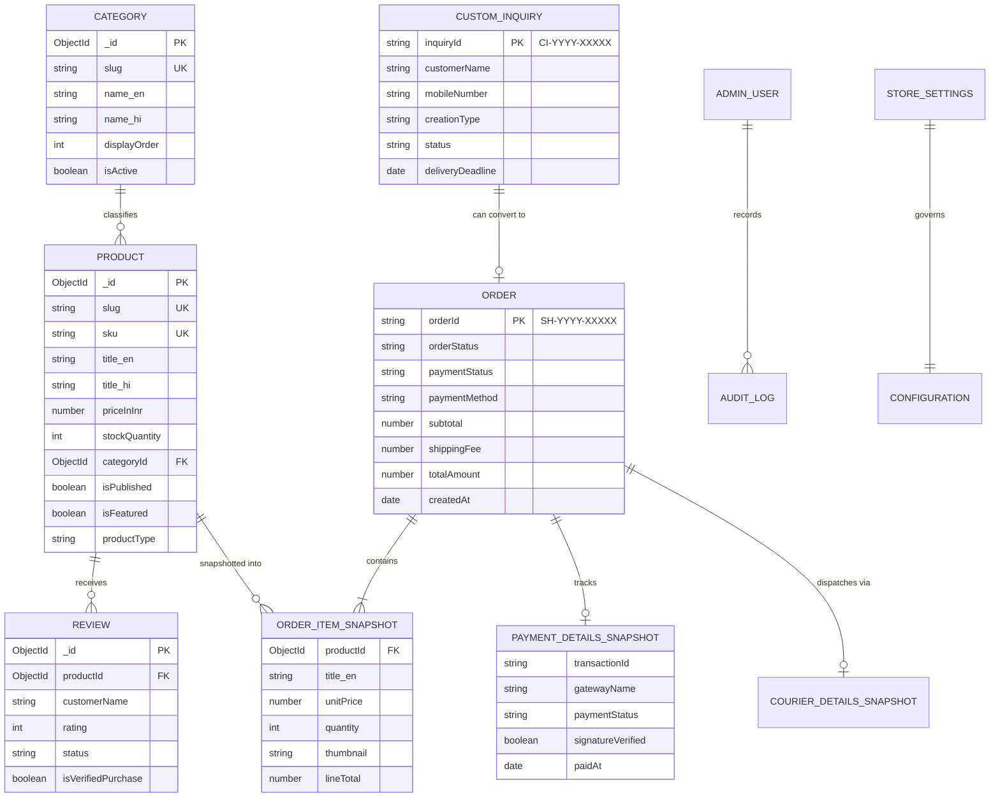

# BACKEND SCHEMA & DATA MODEL SPECIFICATION (BACKEND_SCHEMA)
## Project: Sangita Handmade — Direct-to-Consumer (D2C) E-Commerce Platform

---

| **Document Attribute** | **Specification Details** |
| :--- | :--- |
| **Document Title** | Backend Schema & Database Architecture Specification (BACKEND_SCHEMA) |
| **Document Version** | 1.0.0 (Release Baseline) |
| **Date** | October 14, 2026 |
| **Status** | Approved for Database Implementation & API Engineering |
| **Author / Roles** | Senior Backend Architect, Database Designer, Application Security Engineer |
| **Companion Documents**| [`PRD.md`](file:///c:/Users/DELL/OneDrive/Documents/sangita%20handmade/PRD.md), [`TRD.md`](file:///c:/Users/DELL/OneDrive/Documents/sangita%20handmade/TRD.md), [`APP_FLOW.md`](file:///c:/Users/DELL/OneDrive/Documents/sangita%20handmade/APP_FLOW.md), [`UI_UX_BRIEF.md`](file:///c:/Users/DELL/OneDrive/Documents/sangita%20handmade/UI_UX_BRIEF.md) |
| **Database Engine** | MongoDB (Document Store) via Mongoose ODM |
| **Deployment Target** | MongoDB Atlas (Cluster Tier M0+), Node.js LTS v20+, Next.js Serverless Route Handlers |

---

## 1. Document Overview

This document specifies the complete, authoritative backend database architecture, collection schemas, entity relationships, validation rules, indexing strategies, API data access matrices, and security controls for **Sangita Handmade**.

It translates the business rules from [`PRD.md`](file:///c:/Users/DELL/OneDrive/Documents/sangita%20handmade/PRD.md), architectural requirements from [`TRD.md`](file:///c:/Users/DELL/OneDrive/Documents/sangita%20handmade/TRD.md), user interactions from [`APP_FLOW.md`](file:///c:/Users/DELL/OneDrive/Documents/sangita%20handmade/APP_FLOW.md), and UI constraints from [`UI_UX_BRIEF.md`](file:///c:/Users/DELL/OneDrive/Documents/sangita%20handmade/UI_UX_BRIEF.md) into concrete database schemas and data lifecycle rules.

---

## 2. Scope and Source Documents

### 2.1 Sources of Truth
All data models and field structures within this document are derived directly from the four preceding project documents:
1. [`PRD.md`](file:///c:/Users/DELL/OneDrive/Documents/sangita%20handmade/PRD.md) (Product Requirements Baseline v1.0.0)
2. [`TRD.md`](file:///c:/Users/DELL/OneDrive/Documents/sangita%20handmade/TRD.md) (Technical Requirements Baseline v1.0.0)
3. [`APP_FLOW.md`](file:///c:/Users/DELL/OneDrive/Documents/sangita%20handmade/APP_FLOW.md) (Application Workflows Baseline v1.0.0)
4. [`UI_UX_BRIEF.md`](file:///c:/Users/DELL/OneDrive/Documents/sangita%20handmade/UI_UX_BRIEF.md) (UI/UX Design Brief Baseline v1.0.0)

### 2.2 Scope Boundaries
- **In Scope:** MongoDB document schemas, embedded subdocument snapshots, validation rules, indexing designs, atomic inventory locking queries, and server-side data access matrices.
- **Out of Scope:** Executable application code files, package installation commands, and live database migrations. All JSON schemas in this document are provided as **illustrative architectural specifications**, not executable code.

---

## 3. Architecture Assumptions

1. **Document-Oriented Database:** MongoDB Atlas is the persistence engine, operated via Mongoose ODM in a TypeScript runtime.
2. **Denormalized Historical Snapshots:** E-commerce transactions require immutable historical records. Line items, item prices, customer names, and shipping addresses are snapshotted inside the order document at the time of purchase to ensure that future product edits or deletions never alter past receipts.
3. **Guest Checkout Priority:** Mandatory customer registration is avoided. Guest checkout records are embedded directly within each order document, eliminating the need for an unauthenticated public Customer collection.
4. **Decoupled State Machines:** Order status (`orderStatus`) and payment status (`paymentStatus`) operate as independent, decoupled state fields.
5. **Zero Trust on Client Financials:** All subtotal additions, flat shipping calculations, and inventory validations execute exclusively on the server.

---

## 4. Entity Relationship Overview



---

## 5. Product Schema (`products` Collection)

### 5.1 Purpose
Stores catalog information for handmade pipe-cleaner flowers, everlasting bouquets, personalized gift sets, and home decor items. Supports bilingual content (English and Hindi), multi-image galleries, fixed pricing in INR, real-time stock levels, and categorization.

### 5.2 Field Definitions & Validation Rules

```
+----------------------------------------------------------------------------------------------------+
| PRODUCT COLLECTION SCHEMA SPECIFICATION                                                            |
+----------------------------------------------------------------------------------------------------+
| Field Name           | Type     | Req? | Validation / Constraints      | Example Value             |
| :------------------- | :------- | :--: | :---------------------------- | :------------------------ |
| `_id`                | ObjectId | Yes  | Auto-generated Mongo ID       | `ObjectId("670d8a1e...")` |
| `title_en`           | String   | Yes  | Trim, 3–120 characters        | `"Lavender Dreams Bouquet"`|
| `title_hi`           | String   | Yes  | Trim, 3–150 characters        | `"लैवेंडर ड्रीम्स गुलदस्ता"` |
| `slug`               | String   | Yes  | Unique, lowercase, kebab-case  | `"lavender-dreams-bouquet"`|
| `sku`                | String   | Yes  | Unique, uppercase, pattern     | `"SH-BQT-LAV-001"`         |
| `description_en`     | String   | Yes  | Trim, 10–3000 characters      | Full English description  |
| `description_hi`     | String   | Yes  | Trim, 10–3000 characters      | Full Hindi description    |
| `categoryId`         | ObjectId | Yes  | Ref: `categories._id`, indexed| `ObjectId("670d8900...")` |
| `priceInInr`         | Number   | Yes  | Min: 1, Max: 100000, Integer   | `1899`                     |
| `originalPriceInInr` | Number   | No   | Min: 1, optional comparison    | `2199`                     |
| `images`             | Array    | Yes  | Min 1, Max 6 image objects     | `[{ url, alt_en... }]`    |
| `stockQuantity`      | Number   | Yes  | Min: 0, default: 0, Integer    | `5`                        |
| `isPublished`        | Boolean  | Yes  | Default: false, indexed        | `true`                     |
| `isFeatured`         | Boolean  | Yes  | Default: false, indexed        | `true`                     |
| `productType`        | String   | Yes  | Enum: READY_MADE, CUSTOMIZABLE | `"READY_MADE"`             |
| `materials_en`       | String   | No   | Max 500 characters             | `"Chenille stems, wire"`  |
| `materials_hi`       | String   | No   | Max 500 characters             | `"चेनिल तार, फ्लोरल टेप"` |
| `dimensions_en`      | String   | No   | Max 200 characters             | `"35cm H x 20cm W"`        |
| `careGuide_en`       | String   | No   | Max 1000 characters            | Care & dusting advice      |
| `seoTitle_en`        | String   | No   | Max 70 characters              | Meta title for search      |
| `seoDescription_en`  | String   | No   | Max 160 characters             | Meta description           |
| `createdAt`          | Date     | Yes  | Auto timestamp                 | `2026-10-14T10:00:00Z`     |
| `updatedAt`          | Date     | Yes  | Auto timestamp                 | `2026-10-14T12:30:00Z`     |
+----------------------------------------------------------------------------------------------------+
```

### 5.3 Embedded Sub-Schema: `ProductImage`
```json
{
  "url": "https://res.cloudinary.com/sangita/image/upload/v1/products/lavender-01.webp",
  "alt_en": "Artisanal lavender pipe-cleaner bouquet wrapped in satin ribbon",
  "alt_hi": "सैटिन रिबन में लिपटा हस्तनिर्मित लैवेंडर पाइप-क्लीनर गुलदस्ता",
  "isMain": true,
  "displayOrder": 1
}
```

### 5.4 Relationships & Integrity
- **Category:** Linked to `categories` via `categoryId` (`foreignField: "_id"`).
- **Reviews:** One-to-many relationship; reviews reference `productId`.
- **Soft Deletion / Archival:** If an active product is deleted while existing historical orders reference it, the admin action sets `isPublished: false` rather than executing a hard database document removal.

---

## 6. Category Schema (`categories` Collection)

### 6.1 Purpose
Stores product categories (*Flowers, Bouquets, Custom Orders, Gifts, Decor*). Allows the store owner to add, reorder, or update catalog categories dynamically without code changes.

### 6.2 Field Definitions & Validation Rules

```
+----------------------------------------------------------------------------------------------------+
| CATEGORY COLLECTION SCHEMA SPECIFICATION                                                           |
+----------------------------------------------------------------------------------------------------+
| Field Name      | Type     | Req? | Validation / Constraints      | Example Value                  |
| :-------------- | :------- | :--: | :---------------------------- | :----------------------------- |
| `_id`           | ObjectId | Yes  | Auto-generated Mongo ID       | `ObjectId("670d8900...")`      |
| `name_en`       | String   | Yes  | Unique, trim, 2–50 characters  | `"Bouquets"`                   |
| `name_hi`       | String   | Yes  | Trim, 2–50 characters          | `"गुलदस्ते"`                   |
| `slug`          | String   | Yes  | Unique, lowercase, kebab-case  | `"bouquets"`                   |
| `description_en`| String   | No   | Max 500 characters             | `"Everlasting handcrafted..."` |
| `description_hi`| String   | No   | Max 500 characters             | Hindi category description     |
| `imageUrl`      | String   | No   | Valid URL format               | Banner thumbnail URL           |
| `displayOrder`  | Number   | Yes  | Integer, default: 0            | `1`                             |
| `isActive`      | Boolean  | Yes  | Default: true, indexed         | `true`                          |
| `createdAt`     | Date     | Yes  | Auto timestamp                 | `2026-10-14T10:00:00Z`          |
| `updatedAt`     | Date     | Yes  | Auto timestamp                 | `2026-10-14T10:00:00Z`          |
+----------------------------------------------------------------------------------------------------+
```

---

## 7. Customer & Guest Checkout Schema

### 7.1 Architecture: Embedded vs. Separate Collection
- **Decision:** Guest customer details are stored as an **embedded subdocument inside each `Order` document**.
- **Rationale:** 
  1. [`PRD.md`](file:///c:/Users/DELL/OneDrive/Documents/sangita%20handmade/PRD.md) strictly mandates a frictionless guest checkout experience without compulsory user registration.
  2. Creating an unauthenticated, public `customers` collection introduces privacy vulnerabilities (PII harvesting via unauthenticated phone queries).
  3. Embedding shipping data within the order ensures complete address immutability for past transactions. If a repeat customer enters a new address next month, past tax and shipping records are never corrupted.
  4. If optional registered accounts are added in Phase 3, customer profiles can be introduced seamlessly without altering historical orders.

### 7.2 Embedded Sub-Schema: `CustomerAddressSnapshot`

```
+----------------------------------------------------------------------------------------------------+
| EMBEDDED GUEST CUSTOMER SNAPSHOT SPECIFICATION                                                     |
+----------------------------------------------------------------------------------------------------+
| Field Name            | Type   | Req? | Validation Rules              | Privacy / Security Rule    |
| :-------------------- | :----- | :--: | :---------------------------- | :------------------------- |
| `fullName`            | String | Yes  | Trim, 3–70 chars              | PII: Hidden from public API |
| `mobileNumber`        | String | Yes  | Regex: `^[6-9]\d{9}$` (India)  | PII: Strict server validate |
| `email`               | String | No   | Valid email format, lowercase  | Optional, receipt delivery  |
| `address.houseStreet` | String | Yes  | Trim, 5–150 chars             | Delivery fulfillment only   |
| `address.localityArea`| String | Yes  | Trim, 3–100 chars             | Landmark / area info        |
| `address.city`        | String | Yes  | Trim, 2–60 chars              | Destination city            |
| `address.state`       | String | Yes  | Enum: 28 Indian States & 8 UTs | Indian delivery scope       |
| `address.pinCode`     | String | Yes  | Regex: `^[1-9][0-9]{5}$` (PIN) | Pan-India PIN validation    |
| `deliveryInstructions`| String | No   | Max 300 chars, sanitized      | Gift notes / packaging notes|
+----------------------------------------------------------------------------------------------------+
```

---

## 8. Cart Architecture & Schema Design

### 8.1 Architecture Decision: Client-Side Persistent Cart vs. Database Cart
- **Architectural Baseline:** **Client-Side Persistent Cart** stored in `localStorage` under key `sangita_cart_v1` via React Context, with server-side validation on checkout entry (`POST /api/checkout/validate`).
- **Trade-Off Analysis:**
  - *Database Cart Drawbacks for Guest Stores:* Requires tracking anonymous guest session cookies, generates millions of ephemeral abandoned cart records in MongoDB, demands aggressive TTL cleanup background jobs, and wastes free-tier MongoDB storage.
  - *Client-Side Cart Advantages:* 100% free, zero database load during idle browsing, resilient across page refreshes and browser tab closures, and re-validates stock atomically before payment authorization.
- **Optional Server-Side Cart Schema (For Multi-Device Sync):** If persistent cross-device carts are ever required, the following schema design is pre-architected:

```json
{
  "_id": "ObjectId('670d9000...')",
  "guestSessionId": "sess_f839b2a19c",
  "items": [
    {
      "productId": "ObjectId('670d8a1e...')",
      "quantity": 2,
      "addedAt": "2026-10-14T11:00:00Z"
    }
  ],
  "expiresAt": "2026-10-21T11:00:00Z" // TTL index expires after 7 days
}
```

---

## 9. Order Schema (`orders` Collection)

### 9.1 Purpose
Stores finalized customer purchase transactions. Holds an immutable snapshot of ordered line items, pricing, shipping charges, guest delivery addresses, and decoupled status trackers.

### 9.2 Field Definitions & Validation Rules

```
+----------------------------------------------------------------------------------------------------+
| ORDER COLLECTION SCHEMA SPECIFICATION                                                              |
+----------------------------------------------------------------------------------------------------+
| Field Name           | Type     | Req? | Validation / Enum Constraints  | Example Value            |
| :------------------- | :------- | :--: | :----------------------------- | :----------------------- |
| `_id`                | ObjectId | Yes  | Auto-generated Mongo ID        | `ObjectId("670d9100...")`|
| `orderId`            | String   | Yes  | Unique, `^SH-\d{4}-\d{5}$`      | `"SH-2026-10482"`        |
| `customer`           | Object   | Yes  | Embedded Customer Snapshot      | See Section 7.2          |
| `items`              | Array    | Yes  | Min 1 item snapshot             | See Section 9.3          |
| `subtotal`           | Number   | Yes  | Min: 0, server calculated       | `1899`                    |
| `shippingFee`        | Number   | Yes  | Min: 0, from StoreSettings      | `99`                      |
| `discountAmount`     | Number   | Yes  | Default: 0, reserved Phase 2    | `0`                       |
| `totalAmount`        | Number   | Yes  | Subtotal + Shipping - Discount  | `1998`                    |
| `orderStatus`        | String   | Yes  | Enum: PENDING, CONFIRMED,       | `"CONFIRMED"`             |
|                      |          |      | PROCESSING, DISPATCHED,         |                          |
|                      |          |      | DELIVERED, CANCELLED, RETURNED  |                          |
| `paymentStatus`      | String   | Yes  | Enum: PENDING, PAID, FAILED,    | `"PAID"`                  |
|                      |          |      | PENDING_COD, REFUNDED           |                          |
| `paymentMethod`      | String   | Yes  | Enum: GATEWAY, UPI_QR, COD,     | `"GATEWAY"`               |
|                      |          |      | WHATSAPP                        |                          |
| `paymentDetails`     | Object   | No   | Embedded Payment Snapshot       | See Section 10           |
| `courierDetails`     | Object   | No   | Embedded Courier Snapshot       | See Section 16           |
| `cancellationRequest`| Object   | No   | Embedded Cancellation Status    | See Section 9.4          |
| `adminNotes`         | String   | No   | Max 1000 chars, internal only   | `"Packed with ribbon"`   |
| `createdAt`          | Date     | Yes  | Auto timestamp, indexed         | `2026-10-14T10:30:00Z`    |
| `updatedAt`          | Date     | Yes  | Auto timestamp                  | `2026-10-14T10:32:00Z`    |
+----------------------------------------------------------------------------------------------------+
```

### 9.3 Embedded Sub-Schema: `OrderItemSnapshot`
```json
{
  "productId": "ObjectId('670d8a1e...')",
  "title_en": "Lavender Dreams Pipe-Cleaner Bouquet",
  "title_hi": "लैवेंडर ड्रीम्स गुलदस्ता",
  "slug": "lavender-dreams-bouquet",
  "sku": "SH-BQT-LAV-001",
  "unitPrice": 1899,
  "quantity": 1,
  "thumbnail": "https://res.cloudinary.com/sangita/image/upload/v1/products/lavender-thumb.webp",
  "lineTotal": 1899
}
```

### 9.4 Embedded Sub-Schema: `CancellationRequestSnapshot`
```json
{
  "isRequested": false,
  "reason": "Accidental duplicate order",
  "requestedAt": "2026-10-14T11:00:00Z",
  "status": "APPROVED", // PENDING, APPROVED, REJECTED
  "reviewedAt": "2026-10-14T11:30:00Z",
  "adminComment": "Cancelled pre-dispatch; refund issued via Razorpay"
}
```

---

## 10. Payment Schema & Decoupled State Design

### 10.1 Decoupled Order & Payment Architecture
An order entity and payment entity are decoupled. An order may be `CONFIRMED` while payment remains `PENDING_COD`, or an online transaction may transition to `PAID` via webhook before courier packaging starts.

### 10.2 Embedded Sub-Schema: `PaymentDetailsSnapshot`

```
+----------------------------------------------------------------------------------------------------+
| PAYMENT DETAILS SNAPSHOT SPECIFICATION                                                             |
+----------------------------------------------------------------------------------------------------+
| Field Name           | Type    | Req? | Purpose / Constraints         | Example Value              |
| :------------------- | :------ | :--: | :---------------------------- | :------------------------- |
| `gatewayName`        | String  | No   | Enum: RAZORPAY, CASHFREE, NONE| `"RAZORPAY"`                |
| `transactionId`      | String  | No   | Provider transaction ID       | `"pay_O48k29sKl10"`        |
| `gatewayOrderId`     | String  | No   | Provider order token          | `"order_DA810kd912"`       |
| `signatureVerified`  | Boolean | Yes  | Server HMAC validation flag   | `true`                      |
| `paidAt`             | Date    | No   | Timestamp of verified payment | `2026-10-14T10:31:45Z`      |
| `refundReference`    | String  | No   | Provider refund transaction ID| `"rfnd_81048102"`          |
| `refundedAt`         | Date    | No   | Timestamp of refund capture    | `2026-10-14T14:00:00Z`      |
| `failureReason`      | String  | No   | Sanitized bank rejection code | `"PAYMENT_CANCELLED"`      |
+----------------------------------------------------------------------------------------------------+
```

### 10.3 Separate Audit Collection: `payment_events` (Webhook Idempotency)
To guarantee webhook idempotency and prevent duplicate stock deductions or duplicate receipts, incoming webhooks are recorded in a dedicated audit collection:

```json
{
  "_id": "ObjectId('670d9200...')",
  "eventId": "evt_rzp_981410941", // Provider unique event ID
  "provider": "RAZORPAY",
  "eventType": "payment.captured",
  "orderId": "SH-2026-10482",
  "transactionId": "pay_O48k29sKl10",
  "amountInInr": 1998,
  "signatureVerified": true,
  "processedAt": "2026-10-14T10:31:45Z"
}
```
*Index Rule:* `eventId` has a **Unique Index** (`{ eventId: 1 }, { unique: true }`). Duplicate webhook deliveries immediately throw a duplicate key error (`E11000`), allowing the server to return HTTP 200 without executing duplicate mutations.

---

## 11. Custom Order Schema (`custom_inquiries` Collection)

### 11.1 Purpose
Stores bespoke pipe-cleaner floral inquiry briefs submitted through `/custom-order`. These records represent consultation inquiries, **not confirmed purchases or financial liabilities**.

### 11.2 Field Definitions & Validation Rules

```
+----------------------------------------------------------------------------------------------------+
| CUSTOM INQUIRY COLLECTION SCHEMA SPECIFICATION                                                     |
+----------------------------------------------------------------------------------------------------+
| Field Name        | Type     | Req? | Validation Rules              | Example Value                |
| :---------------- | :------- | :--: | :---------------------------- | :--------------------------- |
| `_id`             | ObjectId | Yes  | Auto Mongo ID                 | `ObjectId("670d9300...")`    |
| `inquiryId`       | String   | Yes  | Unique, `^CI-\d{4}-\d{5}$`     | `"CI-2026-00042"`            |
| `customerName`    | String   | Yes  | Trim, 3–70 chars              | `"Meera Patel"`              |
| `mobileNumber`    | String   | Yes  | Regex: `^[6-9]\d{9}$` (India)  | `"9876543210"`               |
| `creationType`    | String   | Yes  | Enum: BRIDAL_BOUQUET,         | `"ANNIVERSARY_KEEPSAKE"`     |
|                   |          |      | BIRTHDAY_BOUQUET, STEMS,      |                              |
|                   |          |      | ANNIVERSARY_KEEPSAKE, OTHER   |                              |
| `occasion`        | String   | No   | Max 100 chars                 | `"10th Wedding Anniversary"` |
| `colorNotes`      | String   | Yes  | Trim, 10–1000 chars           | `"Dusty rose and ivory"`     |
| `budgetRange`     | String   | No   | Enum: UNDER_1000, 1000_2000,   | `"2000_3500"`                |
|                   |          |      | 2000_3500, ABOVE_3500         |                              |
| `deliveryDeadline`| Date     | Yes  | Must be >= Today + 7 days     | `2026-11-12T00:00:00Z`       |
| `referenceImageUrl`| String  | No   | Secure Cloudinary URL (Max 5MB)| Cloud URL                    |
| `additionalNotes` | String   | No   | Max 1000 chars                | Personalization details      |
| `status`          | String   | Yes  | Enum: ENQUIRY_RECEIVED,       | `"ENQUIRY_RECEIVED"`         |
|                   |          |      | CONTACTED, QUOTED,            |                              |
|                   |          |      | CONVERTED_TO_ORDER, DECLINED  |                              |
| `agreedPriceInInr`| Number   | No   | Set upon artisan quote        | `2800`                       |
| `convertedOrderId`| String   | No   | Ref: `orders.orderId`         | `"SH-2026-10499"`            |
| `adminNotes`      | String   | No   | Internal artisan comments     | `"Customer approved quote"`  |
| `createdAt`       | Date     | Yes  | Auto timestamp, indexed       | `2026-10-14T10:45:00Z`       |
| `updatedAt`       | Date     | Yes  | Auto timestamp                | `2026-10-14T10:45:00Z`       |
+----------------------------------------------------------------------------------------------------+
```

---

## 12. Review Schema (`reviews` Collection)

### 12.1 Purpose & Moderation Integrity
Stores customer feedback and ratings. All submissions are automatically quarantined in `status: "PENDING_APPROVAL"`. Reviews are never visible publicly on storefront pages until the admin explicitly approves them.

### 12.2 Verified Purchase Flag Protection
The `isVerifiedPurchase` boolean **cannot be set by client-submitted payloads**. The backend checks whether the reviewer's phone number exists in a completed `DELIVERED` order containing the target `productId`. Only the server may set `isVerifiedPurchase: true`.

### 12.3 Field Definitions & Validation Rules

```
+----------------------------------------------------------------------------------------------------+
| REVIEW COLLECTION SCHEMA SPECIFICATION                                                             |
+----------------------------------------------------------------------------------------------------+
| Field Name          | Type     | Req? | Validation Rules             | Example Value               |
| :------------------ | :------- | :--: | :--------------------------- | :-------------------------- |
| `_id`               | ObjectId | Yes  | Auto Mongo ID                | `ObjectId("670d9400...")`   |
| `productId`         | ObjectId | Yes  | Ref: `products._id`, indexed | `ObjectId("670d8a1e...")`   |
| `customerName`      | String   | Yes  | Trim, 2–50 chars             | `"Ananya R."`               |
| `rating`            | Number   | Yes  | Integer, Min: 1, Max: 5      | `5`                         |
| `reviewText`        | String   | Yes  | Trim, 10–1000 chars          | `"Blooms look so lifelike!"`|
| `photoUrl`          | String   | No   | Cloudinary photo URL         | Review photo URL            |
| `isVerifiedPurchase`| Boolean  | Yes  | Server-evaluated only         | `true`                      |
| `status`            | String   | Yes  | Enum: PENDING_APPROVAL,      | `"PENDING_APPROVAL"`        |
|                     |          |      | APPROVED, REJECTED           |                             |
| `reviewedAt`        | Date     | No   | Admin moderation timestamp    | `2026-10-14T12:00:00Z`      |
| `createdAt`         | Date     | Yes  | Auto timestamp                | `2026-10-14T11:00:00Z`      |
+----------------------------------------------------------------------------------------------------+
```

---

## 13. Admin Authentication Schema (`admin_users` Collection)

### 13.1 Purpose & Password Security
Stores store owner/artisan administrative credentials. Passwords are never stored in plain text. Passwords must be hashed using **bcryptjs with 12 salt rounds**.

### 13.2 Field Definitions & Brute-Force Throttling Rules

```
+----------------------------------------------------------------------------------------------------+
| ADMIN USER COLLECTION SCHEMA SPECIFICATION                                                         |
+----------------------------------------------------------------------------------------------------+
| Field Name       | Type     | Req? | Validation Rules               | Security Handling            |
| :--------------- | :------- | :--: | :----------------------------- | :--------------------------- |
| `_id`            | ObjectId | Yes  | Auto Mongo ID                  | Internal identifier          |
| `username`       | String   | Yes  | Unique, lowercase, 3–30 chars  | Checked during login         |
| `passwordHash`   | String   | Yes  | Salted bcrypt string (12 rds)  | Excluded from query selects  |
| `role`           | String   | Yes  | Enum: SUPER_ADMIN, ARTISAN      | Default: `SUPER_ADMIN`       |
| `failedAttempts` | Number   | Yes  | Integer, default: 0            | Increments on failed password|
| `lockUntil`      | Date     | No   | Expiry of 15-minute lock       | Set when `failedAttempts >= 5`|
| `lastLoginAt`    | Date     | No   | Updated upon successful login  | Audit tracking               |
| `createdAt`      | Date     | Yes  | Auto timestamp                  | Document creation            |
| `updatedAt`      | Date     | Yes  | Auto timestamp                  | Last profile modification    |
+----------------------------------------------------------------------------------------------------+
```

---

## 14. Store Settings Schema (`store_settings` Collection)

### 14.1 Purpose
Stores global store configuration in a single document (`_id: "global_settings"`). Governs flat shipping charges, business contact placeholders, and store announcements.

### 14.2 Field Definitions & Validation Rules

```
+----------------------------------------------------------------------------------------------------+
| STORE SETTINGS COLLECTION SCHEMA SPECIFICATION                                                     |
+----------------------------------------------------------------------------------------------------+
| Field Name               | Type    | Req? | Purpose & Constraints          | Default Working Value     |
| :----------------------- | :------ | :--: | :----------------------------- | :------------------------ |
| `_id`                    | String  | Yes  | Fixed string: "global_settings"| `"global_settings"`        |
| `flatShippingFee`        | Number  | Yes  | Min: 0, Integer                | `99` (Configurable)       |
| `freeShippingThreshold`  | Number  | No   | Optional (e.g. Free above 1999) | `null`                     |
| `isCodEnabled`           | Boolean | Yes  | Master switch for COD checkout | `true`                     |
| `currency`               | String  | Yes  | Fixed enum: "INR"              | `"INR"`                    |
| `storePhonePlaceholder`  | String  | Yes  | Support WhatsApp               | `"[BUSINESS_WHATSAPP]"`   |
| `storeEmailPlaceholder`  | String  | Yes  | Support email                  | `"[BUSINESS_EMAIL]"`      |
| `storeAddressPlaceholder`| String  | Yes  | Physical studio address        | `"[BUSINESS_ADDRESS]"`    |
| `instagramUrlPlaceholder`| String  | Yes  | Instagram profile URL          | `"[INSTAGRAM_URL]"`       |
| `announcementText_en`    | String  | No   | Top banner English             | `"Pan-India Delivery"`    |
| `announcementText_hi`    | String  | No   | Top banner Hindi               | `"पूरे भारत में डिलीवरी"` |
| `updatedAt`              | Date    | Yes  | Auto timestamp                  | Last modified              |
+----------------------------------------------------------------------------------------------------+
```

---

## 15. Inventory & Order Lifecycle Management

### 15.1 Concurrency & Atomic Stock Reservation
To strictly prevent overselling on the last available handmade bouquet without multi-document distributed transaction overhead, stock reservation is executed using **MongoDB Atomic Conditional Operations**:

```typescript
// Atomically decrement stock only if available quantity is sufficient
const reservationResult = await Product.findOneAndUpdate(
  {
    _id: item.productId,
    isPublished: true,
    stockQuantity: { $gte: item.quantity } // Guard condition
  },
  {
    $inc: { stockQuantity: -item.quantity } // Atomic decrement
  },
  { new: true }
);

if (!reservationResult) {
  // Concurrency conflict: Another user purchased the item milliseconds prior
  throw new Error(`INSUFFICIENT_STOCK_${item.productId}`);
}
```

### 15.2 Stock Restoration Matrix
Stock must be restored atomically (`$inc: { stockQuantity: +quantity }`) strictly under these verified conditions:

```
+----------------------------------------------------------------------------------------------------+
| INVENTORY RESTORATION TRIGGER MATRIX                                                               |
+----------------------------------------------------------------------------------------------------+
| Event Trigger           | Precondition                  | Restoration Action   | New Order Status  |
| :---------------------- | :---------------------------- | :------------------- | :---------------- |
| **Payment Timeout**     | Unpaid online order > 30 mins | Increment stock lines| `CANCELLED`       |
| **Customer Drop/Cancel**| Online checkout aborted       | Increment stock lines| `CANCELLED`       |
| **Admin Cancellation**  | Order is pre-dispatch         | Increment stock lines| `CANCELLED`       |
| **Damaged Transit**     | Replacement issued            | No restoration (scrap)| `REPLACED`        |
| **Bespoke Custom Order**| Custom order cancelled        | NO RESTORATION       | `CANCELLED`       |
|                         | (Materials cut/assembled)     | (Materials unusable) |                   |
+----------------------------------------------------------------------------------------------------+
```

---

## 16. Shipping & Tracking Schema

### 16.1 Purpose
Stores courier assignment details within the `Order` document. In Phase 1, courier partner names, tracking AWBs, and tracking URLs are entered manually by the store owner upon parcel handover.

### 16.2 Embedded Sub-Schema: `CourierDetailsSnapshot`

```
+----------------------------------------------------------------------------------------------------+
| COURIER DETAILS SNAPSHOT SPECIFICATION                                                             |
+----------------------------------------------------------------------------------------------------+
| Field Name     | Type   | Req? | Validation Rules               | Example Value                    |
| :------------- | :----- | :--: | :----------------------------- | :------------------------------- |
| `partnerName`  | String | No   | Courier carrier name           | `"Delhivery"`                     |
| `trackingAwb`  | String | No   | Unique carrier consignment No  | `"12849104821"`                   |
| `trackingUrl`  | String | No   | Clickable carrier tracking link | `"https://delhivery.com/track/.."`|
| `dispatchedAt` | Date   | No   | Handover timestamp              | `2026-10-15T14:00:00Z`            |
| `deliveredAt`  | Date   | No   | Delivery confirmation timestamp | `2026-10-18T16:30:00Z`            |
+----------------------------------------------------------------------------------------------------+
```

---

## 17. API & Data Access Matrix

```
+----------------------------------------------------------------------------------------------------+
| API & DATA ACCESS MATRIX                                                                           |
+----------------------------------------------------------------------------------------------------+
| Operation / Endpoint             | Access Level   | Validation Checks          | Expected Response |
| :------------------------------- | :------------- | :------------------------- | :---------------- |
| `GET /api/products`              | Public         | Category, price, inStock   | 200: Product list  |
| `GET /api/products/[slug]`       | Public         | Valid slug string          | 200: Single product|
| `GET /api/categories`            | Public         | None                       | 200: Category list |
| `POST /api/checkout/validate`    | Public (Guest) | Items array, positive qty  | 200: Stock/Prices  |
| `POST /api/orders`               | Public (Guest) | Indian Mobile, PIN, Name   | 201: Order ID      |
| `GET /api/orders/[orderId]`      | Customer/Phone | Order ID + 10-digit mobile | 200: Order summary |
| `POST /api/payments/create-intent`| Public (Guest)| Order ID exists, PENDING   | 200: Gateway Order |
| `POST /api/payments/verify`      | Public (Guest) | HMAC signature matches     | 200: Payment OK    |
| `POST /api/payments/webhook`     | Gateway Secret | Webhook secret verified    | 200: Idempotent OK |
| `POST /api/custom-inquiry`       | Public (Guest) | Mobile, date >= today+7d   | 201: Inquiry ID    |
| `POST /api/reviews`              | Public (Guest) | 1-5 rating, text length    | 201: Review PENDING|
| `POST /api/admin/auth/login`     | Public         | Throttled, bcrypt verify   | 200: Cookie Set    |
| `GET /api/admin/orders`          | Admin Only     | Valid JWT Session Cookie   | 200: Orders table  |
| `PATCH /api/admin/orders/[id]`   | Admin Only     | Valid state transition     | 200: Updated order |
| `POST /api/admin/products`       | Admin Only     | Valid schema, images > 0   | 201: Created prod  |
| `PATCH /api/admin/reviews/[id]`  | Admin Only     | Approve or Reject enum     | 200: Moderated     |
| `GET /api/admin/reports/sales`   | Admin Only     | Valid date range           | 200: Gross sales   |
+----------------------------------------------------------------------------------------------------+
```

---

## 18. Validation Rules

```
+----------------------------------------------------------------------------------------------------+
| FIELD VALIDATION REFERENCE RULES                                                                   |
+----------------------------------------------------------------------------------------------------+
| Data Entity     | Target Field     | Strict Validation Expression                                  |
| :-------------- | :--------------- | :------------------------------------------------------------ |
| **Customer**    | `mobileNumber`   | `^[6-9]\d{9}$` (Strict 10-digit Indian mobile number)          |
| **Customer**    | `pinCode`        | `^[1-9][0-9]{5}$` (Strict 6-digit Indian Postal Code)          |
| **Customer**    | `fullName`       | String, trim, length: 3 to 70 characters                      |
| **Order**       | `orderId`        | `^SH-\d{4}-\d{5}$` (e.g. `SH-2026-10482`)                     |
| **Order Item**  | `quantity`       | Integer, $\ge 1$ and $\le \text{current stock}$               |
| **Product**     | `priceInInr`     | Integer, $\ge 1$ and $\le 100000$                             |
| **Review**      | `rating`         | Integer, $\ge 1$ and $\le 5$                                  |
| **Custom Order**| `deliveryDeadline`| ISO Date $\ge \text{Date.now()} + 7\text{ days}$              |
| **File Upload** | `mimetype`       | Must match: `image/jpeg`, `image/png`, `image/webp` (Max 5MB) |
+----------------------------------------------------------------------------------------------------+
```

---

## 19. Indexing Strategy

```
+----------------------------------------------------------------------------------------------------+
| MONGODB INDEXING STRATEGY                                                                          |
+----------------------------------------------------------------------------------------------------+
| Collection         | Index Fields                       | Index Type    | Query Intent             |
| :----------------- | :--------------------------------- | :------------ | :----------------------- |
| `products`         | `{ slug: 1 }`                      | Unique         | Fast PDP slug lookup     |
| `products`         | `{ sku: 1 }`                       | Unique, Sparse | Inventory management     |
| `products`         | `{ isPublished: 1, categoryId: 1 }`| Compound       | Category filtering       |
| `products`         | `{ isPublished: 1, isFeatured: 1 }`| Compound       | Homepage featured strip  |
| `products`         | `{ isPublished: 1, priceInInr: 1 }`| Compound       | Price sorting/slider     |
| `categories`       | `{ slug: 1 }`                      | Unique         | Category page routing    |
| `categories`       | `{ isActive: 1, displayOrder: 1 }` | Compound       | Sorted navigation tabs   |
| `orders`           | `{ orderId: 1 }`                   | Unique         | Order receipt lookup     |
| `orders`           | `{ "customer.mobileNumber": 1 }`   | Single Field   | Customer order history   |
| `orders`           | `{ orderStatus: 1, createdAt: -1 }`| Compound       | Admin order queues       |
| `payment_events`   | `{ eventId: 1 }`                   | Unique         | Webhook idempotency      |
| `custom_inquiries` | `{ inquiryId: 1 }`                 | Unique         | Inquiry brief tracking   |
| `reviews`          | `{ productId: 1, status: 1 }`      | Compound       | Approved product reviews |
| `admin_users`      | `{ username: 1 }`                  | Unique         | Admin login authentication|
+----------------------------------------------------------------------------------------------------+
```

---

## 20. Security & Privacy Controls

1. **Payment Credential Isolation:** Zero storage of credit card numbers, CVVs, expiration dates, or UPI PINs. All payment tokenization is handled by RBI-compliant aggregators.
2. **PII Protection & Guest Order Privacy:** Public APIs cannot query orders by sequential integer IDs. Order lookup requires both the unique `orderId` (`SH-YYYY-XXXXX`) and matching `customer.mobileNumber`.
3. **NoSQL Injection Defense:** All queries use strongly typed Mongoose schemas with sanitized object inputs, preventing `$where` and `$gt` operator injection attacks.
4. **XSS Defense:** String inputs (customer names, delivery notes, reviews) are stripped of HTML/script tags before database persistence.
5. **Secret Security:** All database connection strings, JWT signing keys, and payment gateway secrets are loaded from server-only environment variables; zero secrets committed to Git.

---

## 21. Error Handling & Logging Architecture

1. **Standardized Error Envelope:**
   ```json
   {
     "success": false,
     "error": {
       "code": "INSUFFICIENT_STOCK",
       "message": "The selected handcrafted item is no longer available in the requested quantity."
     }
   }
   ```
2. **Sanitized Error Logging:** Production server logs must never write plain-text customer phone numbers, full street addresses, or payment gateway secret keys. Errors record error codes, timestamps, and anonymized order references (e.g., `SH-***-10482`).

---

## 22. Confirmed Business Rules

- **Currency:** Indian Rupees (INR, ₹) exclusively.
- **Guest Checkout:** 100% supported without mandatory account creation.
- **Flat Shipping Rate:** Configurable in StoreSettings, defaulting to ₹99.
- **Review Moderation:** Only admin-approved reviews render publicly.
- **Custom Order Nature:** Inquiries are briefs, not auto-confirmed orders.
- **Financial Reporting:** Revenue is reported as Gross Sales and Collected Cash; never labeled as "Profit" without COGS tracking.

---

## 23. Unresolved Decisions & Baseline Defaults

In strict alignment with [`PRD.md`](file:///c:/Users/DELL/OneDrive/Documents/sangita%20handmade/PRD.md), [`TRD.md`](file:///c:/Users/DELL/OneDrive/Documents/sangita%20handmade/TRD.md), [`APP_FLOW.md`](file:///c:/Users/DELL/OneDrive/Documents/sangita%20handmade/APP_FLOW.md), and [`UI_UX_BRIEF.md`](file:///c:/Users/DELL/OneDrive/Documents/sangita%20handmade/UI_UX_BRIEF.md), the following items are architected with flexible placeholders/defaults and require confirmation from store owner Sangita before live production launch:

| # | Item / Decision Area | BACKEND_SCHEMA Working Baseline | Owner Confirmation Required Before Launch |
| :---: | :--- | :--- | :--- |
| **1** | **Flat Shipping Rate** | Defaulted to ₹99 in StoreSettings | Confirm final flat fee or free shipping threshold. |
| **2** | **Payment Gateway** | Schema supports Razorpay & Cashfree | Confirm merchant KYC approval and active credentials. |
| **3** | **Official Contact Info** | Handled via placeholders (`[BUSINESS_WHATSAPP]`, etc.) | Provide active phone number and support email address. |
| **4** | **Studio Address** | Placeholder `[BUSINESS_ADDRESS]` | Provide official physical workshop address. |
| **5** | **Instagram Profile** | Placeholder `[INSTAGRAM_URL]` | Provide active Instagram handle URL. |
| **6** | **Courier Partners** | Manual AWB & tracking URL entry | Confirm primary carrier (Delhivery, India Post, Shiprocket). |
| **7** | **Production Domain** | Vercel default domain | Confirm purchased custom domain name. |

---

## 24. Implementation Notes

- **ODM Setup:** Use Mongoose schemas with `{ timestamps: true }` to automatically maintain `createdAt` and `updatedAt`.
- **Database Connection:** Use global connection caching (`lib/db.ts`) to prevent serverless function connection leaks.
- **Initial Admin Seeding:** Initial admin account created via a secure one-time database seed script referencing `ADMIN_DEFAULT_USERNAME` and `ADMIN_DEFAULT_PASSWORD` environment variables.
- **Testing Database:** Use in-memory MongoDB (`mongodb-memory-server`) for unit and integration testing of atomic inventory operations and webhook idempotency.

---

*End of Backend Schema & Database Architecture Specification (BACKEND_SCHEMA.md) — Sangita Handmade*
