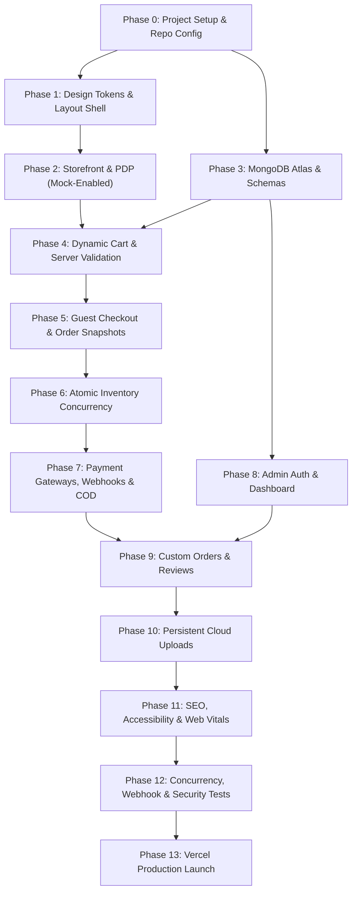

# IMPLEMENTATION PLAN (IMPLEMENTATION_PLAN)
## Project: Sangita Handmade — Direct-to-Consumer (D2C) E-Commerce Platform

---

| **Document Attribute** | **Specification Details** |
| :--- | :--- |
| **Document Title** | Engineering Implementation Plan & Phase-by-Phase Delivery Roadmap |
| **Document Version** | 1.0.0 (Execution Baseline) |
| **Date** | October 14, 2026 |
| **Status** | Approved for Execution / Ready for Phase 0 |
| **Author / Roles** | Senior Software Architect, Technical Project Manager, Full-Stack Development Planner |
| **Companion Documents**| [`PRD.md`](file:///c:/Users/DELL/OneDrive/Documents/sangita%20handmade/PRD.md), [`TRD.md`](file:///c:/Users/DELL/OneDrive/Documents/sangita%20handmade/TRD.md), [`APP_FLOW.md`](file:///c:/Users/DELL/OneDrive/Documents/sangita%20handmade/APP_FLOW.md), [`UI_UX_BRIEF.md`](file:///c:/Users/DELL/OneDrive/Documents/sangita%20handmade/UI_UX_BRIEF.md), [`BACKEND_SCHEMA.md`](file:///c:/Users/DELL/OneDrive/Documents/sangita%20handmade/BACKEND_SCHEMA.md) |
| **Project State** | **Core Commerce & Admin Implementation Complete / Build Verified (22/22 Pages)** |

---

## 1. Document Overview

This **Implementation Plan (IMPLEMENTATION_PLAN.md)** provides the master execution roadmap for building and deploying the **Sangita Handmade** direct-to-consumer e-commerce platform.

It decomposes the entire system into **14 sequential, verifiable execution phases** (Phases 0 through 13), complete with discrete task breakdowns, acceptance criteria, dependency graphs, security checkpoints, a comprehensive risk register, environment checklists, and a living progress-tracking system.

Every task in this plan is structured so that a full-stack developer or an automated coding agent can implement and verify each milestone incrementally without making unsupported assumptions.

---

## 2. Source Documents and Assumptions

### 2.1 Complete Source Document Verification
This implementation plan strictly derives from the five approved planning documents residing in the project root:

1. [`PRD.md`](file:///c:/Users/DELL/OneDrive/Documents/sangita%20handmade/PRD.md) (Product Requirements Baseline v1.0.0) — Confirmed business goals, scope boundaries, P0/P1/P2 priorities, brand positioning, and legal/policy mandates.
2. [`TRD.md`](file:///c:/Users/DELL/OneDrive/Documents/sangita%20handmade/TRD.md) (Technical Requirements Baseline v1.0.0) — Confirmed stack: Next.js 14+ App Router, TypeScript (Strict), Vanilla CSS with custom properties, MongoDB Atlas with Mongoose ODM, JWT in `HttpOnly` cookie, and Vercel hosting.
3. [`APP_FLOW.md`](file:///c:/Users/DELL/OneDrive/Documents/sangita%20handmade/APP_FLOW.md) (Application Workflows Baseline v1.0.0) — End-to-end customer and administrative journeys, failure-recovery matrices, and testable user scenarios.
4. [`UI_UX_BRIEF.md`](file:///c:/Users/DELL/OneDrive/Documents/sangita%20handmade/UI_UX_BRIEF.md) (UI/UX Design Brief Baseline v1.0.0) — Visual identity, master color tokens (`#FFF8EF`, `#722F3E`, `#C6A15B`), typography scales, wireframes, and responsive layout behavior.
5. [`BACKEND_SCHEMA.md`](file:///c:/Users/DELL/OneDrive/Documents/sangita%20handmade/BACKEND_SCHEMA.md) (Backend Schema Baseline v1.0.0) — MongoDB document schemas, embedded snapshots, atomic conditional updates for inventory, and indexing strategies.

*Document Integrity Notice:* All five source documents are present, complete, and verified. Zero referenced files are missing.

### 2.2 Core Architectural & Operational Assumptions
- **Language & Runtime:** TypeScript strictly enforced (`"strict": true`) on Node.js LTS v20+.
- **Zero Account Guest Checkout:** Customer registration is not required. Shipping data is captured and embedded directly in the order.
- **State Decoupling:** Order lifecycle (`orderStatus`) and financial capture (`paymentStatus`) operate as independent state fields.
- **Server-Side Trust:** All calculations (subtotals, shipping fees, stock availability) and payment verifications occur on the server.
- **Cost Discipline:** Initial build operates on ₹0 baseline recurring hosting costs using Vercel serverless and MongoDB Atlas (M0).

---

## 3. Project Scope

```
+----------------------------------------------------------------------------------------------------+
| SANGITA HANDMADE — SCOPE BOUNDARIES FOR PHASE 1 LAUNCH                                             |
+----------------------------------------------------------------------------------------------------+
| IN SCOPE (PHASE 1 MUST-HAVES - P0)                 | OUT OF SCOPE (DEFERRED TO PHASE 2 & BEYOND)   |
| :------------------------------------------------- | :-------------------------------------------- |
| • Luxury storefront with brand design tokens       | • Mandatory customer account registration     |
| • Bilingual UI support (English default & Hindi)   | • Complex automated coupon/discount engine    |
| • 5 Product Categories (Flowers, Bouquets, etc.)   | • Customer loyalty / rewards scheme           |
| • Real-time search, category & price filtering     | • Multi-currency conversions (INR ₹ only)     |
| • Multi-photo zoomable gallery & stock badges      | • Automated carrier pickup API integration    |
| • Session-persistent cart (localStorage)           | • Automated WhatsApp Cloud API webhooks       |
| • Guest checkout with strict Indian address checks | • Cost-of-goods-sold (COGS) profit accounting |
| • Multi-channel payment options (Gateway, COD, etc)| • Inventory supplier/raw material management  |
| • Server-side HMAC payment verification            | • Multi-vendor marketplace capabilities       |
| • Dedicated Custom Order request intake form       |                                               |
| • Moderated genuine customer reviews module        |                                               |
| • Complete protected Admin Control Center          |                                               |
| • Product CRUD, stock controls, and order tracker  |                                               |
| • Courier AWB tracking number assignment           |                                               |
| • Static compliance policy pages                   |                                               |
+----------------------------------------------------------------------------------------------------+
```

---

## 4. Implementation Strategy

To ensure rapid delivery without regression, the build follows **five foundational rules**:

1. **Incremental Verification Over "Big Bang" Releases:** Each phase must pass its specific verification checklist before downstream phases begin.
2. **Mock-Data Decoupling:** Phase 2 implements complete visual pages and interactive components using structured mock data (`lib/mockData.ts`) matching `BACKEND_SCHEMA.md` so that the client experience can be reviewed immediately without waiting for database provisioning.
3. **Defense-in-Depth Concurrency:** Inventory deduction relies on atomic conditional queries (`stockQuantity: { $gte: qty }`) rather than fragile read-modify-write patterns.
4. **Authentic Visual Standards:** Product cards and galleries will use authentic handmade photographs supplied by the owner; zero AI or stock flower imagery will be represented as genuine products.
5. **No Secret Leaks:** All API keys, database URIs, and webhook secrets reside strictly in environment variables; `.gitignore` is established in Phase 0.

---

## 5. Phase-by-Phase Roadmap

```
+----------------------------------------------------------------------------------------------------+
| SANGITA HANDMADE — 14-PHASE IMPLEMENTATION ROADMAP                                                 |
+----------------------------------------------------------------------------------------------------+
| Phase 0: Project Setup, Tooling & Workspace Reconciled                                             |
| Phase 1: Design Tokens, Layout Foundation & Bilingual Shell                                        |
| Phase 2: Public Storefront Pages & Catalog Interfaces (Mock-Enabled)                                |
| Phase 3: Database Connection Pool, Mongoose Schemas & API Foundation                               |
| Phase 4: Dynamic Catalog Retrieval, Live Cart & Server-Side Price Verification                     |
| Phase 5: Guest Checkout, Address Validation & Order Snapshot Creation                              |
| Phase 6: Atomic Inventory Reservation, Concurrency Defense & Stock Restoration                     |
| Phase 7: Payment Gateways (Razorpay/Cashfree), Webhook Idempotency & COD Pipelines                |
| Phase 8: Admin Authentication, Protected Middleware & Operational Dashboard                         |
| Phase 9: Custom-Order Inquiries, Review Moderation & WhatsApp Connect                              |
| Phase 10: Persistent Cloud Media Storage & Image Optimization Pipelines                            |
| Phase 11: SEO Metadata, Web Vitals Performance & WCAG 2.1 AA Accessibility                         |
| Phase 12: Comprehensive Automated Testing, Security Audits & Concurrency Stress Tests              |
| Phase 13: Production Deployment (Vercel + Atlas), Verification & Launch Readiness                  |
+----------------------------------------------------------------------------------------------------+
```

---

## 6. Detailed Task Tables

*Status Definitions:* `Not Started` | `In Progress` | `Blocked` | `Completed`  
*Current Project State:* **All tasks are currently `Not Started`.**

### Phase 0 — Review and Project Setup

| Task ID | Task Name | Description | Dependencies | Priority | Expected Result | Verification / Acceptance Criteria | Status |
| :--- | :--- | :--- | :---: | :---: | :--- | :--- | :---: |
| **SETUP-01** | Workspace & Tooling Verification | Verify Node.js v20+, npm, and initialize Git repository. | None | Critical | Git repo active; `.gitignore` configured. | `git status` executes cleanly; `node -v` $\ge 20$. | Not Started |
| **SETUP-02** | Next.js App Initialization | Initialize Next.js 14+ with App Router and TypeScript Strict mode. | SETUP-01 | Critical | Standard Next.js directory structure created. | `npm run build` succeeds on clean boilerplate. | Not Started |
| **SETUP-03** | Environment Template (`.env.example`) | Create comprehensive `.env.example` documenting all configuration keys with placeholders. | SETUP-02 | High | Template committed; no real secrets in Git. | `.env.example` matches TRD Section 16. | Not Started |
| **SETUP-04** | Project Directory Structuring | Establish modular folder structure: `/components`, `/lib`, `/models`, `/messages`, `/context`. | SETUP-02 | Medium | Clean, predictable architectural scaffolding. | Folders exist with placeholder `.gitkeep` files. | Not Started |

---

### Phase 1 — Foundation and Design System

| Task ID | Task Name | Description | Dependencies | Priority | Expected Result | Verification / Acceptance Criteria | Status |
| :--- | :--- | :--- | :---: | :---: | :--- | :--- | :---: |
| **UI-01** | CSS Custom Properties & Tokens | Implement master palette (`#FFF8EF`, `#722F3E`, `#C6A15B`), typography, and spacing tokens in `globals.css`. | SETUP-04 | Critical | Design tokens accessible globally across CSS modules. | Color contrast ratio $\ge 4.5:1$ on text. | Not Started |
| **UI-02** | Typography & Font Loading | Configure Google Fonts: Cormorant Garamond (Serif), Montserrat (Sans), Noto Sans Devanagari. | UI-01 | High | Font families render correctly across EN & HI. | Fonts render without FOIT/layout shifts. | Not Started |
| **UI-03** | Core Shell Layout | Build global responsive `Header`, `Footer`, `AnnouncementBar`, and mobile navigation drawer. | UI-01 | Critical | Sticky header, mobile hamburger, footer links. | Seamless navigation across 360px–1440px viewports. | Not Started |
| **UI-04** | Bilingual Localization Core | Implement `LocaleContext` reading `/messages/en.json` and `/messages/hi.json` with header switcher toggle. | UI-02 | Critical | Instant UI language toggle between EN and HI. | Language switches without page reload or cart wipe. | Not Started |
| **UI-05** | Shared Primitive Components | Build `Button` (Primary, Secondary, WhatsApp), `InputField`, `BadgePill`, `Spinner`, `ToastAlert`. | UI-01 | High | Reusable component library adhering to design brief. | All interaction states (hover, focus, disabled) pass. | Not Started |

---

### Phase 2 — Public Website and Frontend (Mock-Enabled)

| Task ID | Task Name | Description | Dependencies | Priority | Expected Result | Verification / Acceptance Criteria | Status |
| :--- | :--- | :--- | :---: | :---: | :--- | :--- | :---: |
| **PAGE-01** | Homepage Assembly | Implement Hero section, Category Grid, Featured Products, Craft Story, and Genuine Reviews section. | UI-03, UI-04 | Critical | Visually stunning luxury homepage matching UI Brief. | Zero fake statistics; reviews collapse if empty. | Not Started |
| **PAGE-02** | Shop Catalog & Product Cards | Build `/shop` with category tabs, search input, price slider, in-stock toggle, and 4:5 portrait product cards. | UI-05 | Critical | Interactive catalog browsing with mock data. | Search debounced 300ms; filters update URL params. | Not Started |
| **PAGE-03** | Product Detail Page (PDP) | Build `/shop/[slug]` with multi-image gallery, zoom modal, price display, delivery notes, and WhatsApp trigger. | PAGE-02 | Critical | Complete PDP with sticky mobile action bar. | WhatsApp button generates pre-filled product query. | Not Started |
| **PAGE-04** | Slide-Over Cart Drawer & Page | Implement `CartDrawer` with quantity steppers, item removal, flat shipping calculator, and subtotal math. | UI-05 | Critical | Cart slides in smoothly; quantities bounded by stock. | Cart state survives browser refresh (localStorage). | Not Started |
| **PAGE-05** | Guest Checkout Interface | Implement `/checkout` with strict Indian address fields (10-digit phone, 6-digit PIN) and order review step. | PAGE-04 | Critical | 2-step checkout flow without forced registration. | Red inline validation on invalid PIN or phone. | Not Started |
| **PAGE-06** | Custom Order Inquiry Page | Build `/custom-order` intake form (type, occasion, palette, budget, date picker, photo drag-and-drop). | UI-05 | High | Bespoke request form with clear inquiry disclaimer. | Date picker enforces $\ge 7$ days in advance. | Not Started |
| **PAGE-07** | Legal & Informational Pages | Implement `/privacy-policy`, `/terms`, `/shipping-policy`, `/cancellation-refunds`, and `/contact`. | UI-03 | High | Complete, compliant policy pages with placeholders. | All placeholders (`[BUSINESS_WHATSAPP]`) visible. | Not Started |

---

### Phase 3 — Database and Backend Foundation

| Task ID | Task Name | Description | Dependencies | Priority | Expected Result | Verification / Acceptance Criteria | Status |
| :--- | :--- | :--- | :---: | :---: | :--- | :--- | :---: |
| **DB-01** | MongoDB Connection Singleton | Configure cached Mongoose connection pool in `lib/db.ts` to prevent serverless connection exhaustion. | SETUP-02 | Critical | Reusable database connection pool active. | Reconnects gracefully without spawning new sockets. | Not Started |
| **DB-02** | Mongoose Model Definitions | Implement TypeScript schemas: `Product`, `Category`, `Order`, `CustomInquiry`, `Review`, `AdminUser`, `StoreSettings`. | DB-01 | Critical | Strict schemas matching `BACKEND_SCHEMA.md`. | Schema validation blocks negative stock/prices. | Not Started |
| **DB-03** | Database Seeding Script | Create idempotent seed script (`scripts/seed.ts`) populating initial categories and sample products. | DB-02 | High | Local database populated with valid test catalog. | Seed executes without duplicate key collisions. | Not Started |
| **DB-04** | Public Catalog API Routes | Implement `GET /api/products`, `GET /api/products/[slug]`, and `GET /api/categories` with caching headers. | DB-02 | Critical | Public read APIs serving sanitized JSON data. | Fast responses ($< 150\text{ms}$); indexes utilized. | Not Started |

---

### Phase 4 — Shopping and Cart

| Task ID | Task Name | Description | Dependencies | Priority | Expected Result | Verification / Acceptance Criteria | Status |
| :--- | :--- | :--- | :---: | :---: | :--- | :--- | :---: |
| **CART-01** | Cart-to-API Integration | Connect `CartContext` to live catalog; replace mock data with live database product queries. | DB-04, PAGE-04 | Critical | Storefront products add to cart seamlessly. | Product pricing matches database exactly. | Not Started |
| **CART-02** | Server-Side Cart Revalidation | Implement `POST /api/checkout/validate` checking live stock and prices before allowing checkout progression. | CART-01 | Critical | Server detects price changes or sold-out units. | User alerted if an item sold out while in cart. | Not Started |
| **CART-03** | Dynamic Shipping Calculation | Wire flat shipping charge from `StoreSettings` collection into cart subtotal calculations. | CART-02 | High | Shipping fee added transparently to grand total. | Configurable via database (default: ₹99). | Not Started |

---

### Phase 5 — Guest Checkout and Orders

| Task ID | Task Name | Description | Dependencies | Priority | Expected Result | Verification / Acceptance Criteria | Status |
| :--- | :--- | :--- | :---: | :---: | :--- | :--- | :---: |
| **ORDER-01** | Server Order Creation Route | Implement `POST /api/orders` capturing customer shipping details, items snapshot, and decoupled statuses. | CART-02 | Critical | Order created in database with status `PENDING`. | Human-readable `orderId` (`SH-YYYY-XXXXX`) generated. | Not Started |
| **ORDER-02** | Order Snapshot Immutability | Ensure purchased line items store historical prices, titles, and thumbnails within the order document. | ORDER-01 | Critical | Future product catalog edits do not corrupt order. | Editing product price does not alter past orders. | Not Started |
| **ORDER-03** | Order Confirmation Page | Build `/checkout/confirmation/[orderId]` displaying receipt, delivery address, and courier tracking preview. | ORDER-01 | Critical | Customer receives immediate on-screen receipt. | Includes one-click "Save on WhatsApp" action. | Not Started |
| **ORDER-04** | Secure Guest Order Lookup | Implement `GET /api/orders/[orderId]` requiring mobile number match to prevent unauthorized order snooping. | ORDER-03 | High | Order data accessible only to authorized customer. | Querying order with wrong phone returns 403. | Not Started |

---

### Phase 6 — Inventory and Order Lifecycle

| Task ID | Task Name | Description | Dependencies | Priority | Expected Result | Verification / Acceptance Criteria | Status |
| :--- | :--- | :--- | :---: | :---: | :--- | :--- | :---: |
| **INV-01** | Atomic Stock Reservation | Implement atomic conditional decrement (`stockQuantity: { $gte: qty }`) at the point of order creation. | ORDER-01 | Critical | Prevents race condition overselling on last unit. | Second concurrent buyer receives "Sold Out". | Not Started |
| **INV-02** | Automated Stock Restoration | Build stock restoration logic for payment timeouts (>30 mins) and pre-dispatch customer cancellations. | INV-01 | Critical | Cancelled items released back to available stock. | Product `stockQuantity` increments accurately. | Not Started |
| **INV-03** | Bespoke Inventory Isolation | Enforce rule: Custom orders do not decrement ready-made catalog inventory. | INV-01 | High | Custom creations tracked separately in inquiries. | Standard product stock unaffected by custom briefs. | Not Started |

---

### Phase 7 — Payments

| Task ID | Task Name | Description | Dependencies | Priority | Expected Result | Verification / Acceptance Criteria | Status |
| :--- | :--- | :--- | :---: | :---: | :--- | :--- | :---: |
| **PAY-01** | Cash on Delivery (COD) Flow | Wire COD payment method: sets `orderStatus: "CONFIRMED"` and `paymentStatus: "PENDING_COD"`. | ORDER-01 | Critical | Customer places COD order with cash notice. | Admin order view flags cash collection required. | Not Started |
| **PAY-02** | WhatsApp-Assisted Ordering | Wire WhatsApp payment method: creates draft order and launches `wa.me` with pre-filled itemized receipt. | ORDER-01 | High | Direct chat ordering for hesitant shoppers. | WhatsApp pre-fills order ID, items, and address. | Not Started |
| **PAY-03** | Payment Gateway Intent Route | Implement `POST /api/payments/create-intent` initializing Razorpay/Cashfree order tokens. | ORDER-01 | Critical | Client receives gateway token for checkout modal. | Gateway test credentials loaded from env vars. | Not Started |
| **PAY-04** | Server-Side HMAC Verification | Implement `POST /api/payments/verify` calculating HMAC-SHA256 signature against private secret. | PAY-03 | Critical | Browser redirects alone never mark order as paid. | Forged signatures rejected with HTTP 400. | Not Started |
| **PAY-05** | Idempotent Webhook Listener | Build `POST /api/payments/webhook` recording processed events in `payment_events` collection. | PAY-04 | Critical | Duplicate webhook calls safely return 200 OK. | Duplicate callbacks do not re-decrement stock. | Not Started |

---

### Phase 8 — Admin Authentication and Dashboard

| Task ID | Task Name | Description | Dependencies | Priority | Expected Result | Verification / Acceptance Criteria | Status |
| :--- | :--- | :--- | :---: | :---: | :--- | :--- | :---: |
| **ADMIN-01**| Edge Authentication Guard | Implement Next.js `middleware.ts` intercepting `/admin/*` and `/api/admin/*` using signed JWT cookies. | SETUP-02 | Critical | Unauthorized visitors redirected to `/admin/login`. | Direct URL tampering blocked with 401/Redirect. | Not Started |
| **ADMIN-02**| Admin Login & Rate Limiting | Build `/admin/login` verifying salted bcrypt hash with 15-minute lock after 5 failed attempts. | ADMIN-01 | Critical | Secure single-admin login session established. | Brute force attack throttled after 5 tries. | Not Started |
| **ADMIN-03**| Product Management Panel | Build `/admin/products`: CRUD table, photo uploader, pricing, stock adjusters, and publish toggles. | ADMIN-01, DB-02 | Critical | Full catalog control for artisan Sangita. | Admin can add, restock, or unpublish bouquets. | Not Started |
| **ADMIN-04**| Order Fulfillment & Tracking | Build `/admin/orders`: status updates, courier partner selection, AWB tracking number, and tracking URL. | ADMIN-01, ORDER-01 | Critical | Admin transitions orders and attaches tracking. | Tracking details reflect on customer receipt. | Not Started |
| **ADMIN-05**| Sales Reporting Dashboard | Build `/admin/reports`: gross sales, collected cash, pending COD, and bestseller counts (no profit label). | ADMIN-01, ORDER-01 | High | Transparent operational financial overview. | Revenue clearly distinguished from profit. | Not Started |

---

### Phase 9 — Custom Orders, Reviews & Supporting Features

| Task ID | Task Name | Description | Dependencies | Priority | Expected Result | Verification / Acceptance Criteria | Status |
| :--- | :--- | :--- | :---: | :---: | :--- | :--- | :---: |
| **CUST-01** | Custom Inquiry Backend | Wire `POST /api/custom-inquiry` saving bespoke briefs and optional reference photos to database. | PAGE-06, DB-02 | High | Custom requests stored with status `ENQUIRY_RECEIVED`. | Inquiry does not create immediate payment charge. | Not Started |
| **CUST-02** | Admin Custom Request Queue | Build `/admin/custom-inquiries` displaying design briefs with 1-click WhatsApp consultation launcher. | ADMIN-01, CUST-01 | High | Artisan reviews briefs and chats with customer. | One-click WhatsApp link pre-fills inquiry ID. | Not Started |
| **REV-01**  | Review Submission & Quarantine | Wire `POST /api/reviews` saving customer reviews with default status `PENDING_APPROVAL`. | PAGE-03, DB-02 | High | Submitted reviews quarantined immediately. | Reviews remain invisible on storefront. | Not Started |
| **REV-02**  | Admin Review Moderation | Build `/admin/reviews` table allowing admin to "Approve" (makes public) or "Reject" reviews. | ADMIN-01, REV-01 | High | Moderation queue ensures 100% genuine proof. | Approved reviews render instantly on PDP. | Not Started |

---

### Phase 10 — Product Images and Media

| Task ID | Task Name | Description | Dependencies | Priority | Expected Result | Verification / Acceptance Criteria | Status |
| :--- | :--- | :--- | :---: | :---: | :--- | :--- | :---: |
| **MEDIA-01**| Local Starter Media Scaffolding | Organize authentic starter photos in `/public/images/products/` with WebP compression. | SETUP-04 | High | High-res starter bouquets available locally. | Images optimized; no stock/synthetic media. | Not Started |
| **MEDIA-02**| Cloud Upload Integration | Implement Cloudinary (Free Tier) upload route for dynamic admin product photos and custom briefs. | ADMIN-03, CUST-01 | High | Serverless-compatible persistent image storage. | Photos stream to cloud; secure URLs saved in DB. | Not Started |
| **MEDIA-03**| Upload Validation Pipeline | Enforce 5MB file-size limit and buffer magic-byte inspection (JPG/PNG/WebP only) on `/api/upload`. | MEDIA-02 | High | Blocks malicious scripts and oversized files. | Non-image files rejected with HTTP 400. | Not Started |

---

### Phase 11 — SEO, Accessibility and Performance

| Task ID | Task Name | Description | Dependencies | Priority | Expected Result | Verification / Acceptance Criteria | Status |
| :--- | :--- | :--- | :---: | :---: | :--- | :--- | :---: |
| **SEO-01**  | Dynamic Metadata & OpenGraph | Add title templates, meta descriptions, OpenGraph tags, and canonical links to all catalog pages. | PAGE-01, PAGE-02 | High | Social shares render rich previews with bouquet photo.| Social cards display correctly on WhatsApp/FB. | Not Started |
| **SEO-02**  | Robots & XML Sitemap | Generate dynamic `/sitemap.xml` and `/robots.txt` blocking search engines from indexing `/admin/*`. | SEO-01 | Medium | Public catalog indexed; admin routes protected. | Googlebot allowed on `/shop`, excluded from `/admin`.| Not Started |
| **A11Y-01** | WCAG 2.1 AA Accessibility Audit| Verify color contrast, keyboard tab order, ARIA dialogs on drawer cart, and descriptive image alt tags. | UI-01, PAGE-04 | Critical | Accessible to keyboard and screen-reader users. | Contrast $\ge 4.5:1$; visible focus rings active. | Not Started |
| **PERF-01** | Mobile Web Vitals Optimization | Configure `next/image` lazy loading, code-splitting, and CSS pruning to target LCP $\le 2.5\text{s}$. | PAGE-01 | High | Ultra-fast loading on Indian 4G/5G networks. | Lighthouse mobile performance score $\ge 90$. | Not Started |

---

### Phase 12 — Testing and Security Review

| Task ID | Task Name | Description | Dependencies | Priority | Expected Result | Verification / Acceptance Criteria | Status |
| :--- | :--- | :--- | :---: | :---: | :--- | :--- | :---: |
| **TEST-01** | Business Logic Unit Tests | Test cart subtotal math, flat shipping addition, 10-digit mobile regex, and PIN validation rules. | CART-02, ORDER-01 | High | 100% test pass on mathematical calculations. | Jest/Vitest suite passes without errors. | Not Started |
| **TEST-02** | Concurrency Stress Tests | Simulate simultaneous purchases of the final available unit using atomic database runner. | INV-01 | Critical | Zero overselling; database stock never negative. | 1 order confirmed, 1 rejected with 409 conflict. | Not Started |
| **TEST-03** | Webhook Idempotency Tests | Fire duplicate payment gateway webhook events against `/api/payments/webhook`. | PAY-05 | Critical | Exactly 1 payment capture processed; zero duplicates. | Returns 200 OK; inventory unchanged on retry. | Not Started |
| **TEST-04** | Security & Penetration Audit | Verify XSS escaping, NoSQL injection resistance, rate limiting, and unauthenticated admin blockage. | ADMIN-01, ORDER-01 | Critical | Robust application security posture confirmed. | Direct admin API calls return 401 Unauthorized. | Not Started |

---

### Phase 13 — Deployment and Launch Preparation

| Task ID | Task Name | Description | Dependencies | Priority | Expected Result | Verification / Acceptance Criteria | Status |
| :--- | :--- | :--- | :---: | :---: | :--- | :--- | :---: |
| **DEPLOY-01**| MongoDB Atlas Production Setup | Provision free M0 cluster, whitelist Vercel egress IPs, and test secure TLS connection URI. | DB-01 | Critical | Production database ready with automated backups. | Serverless functions connect with pooled sockets. | Not Started |
| **DEPLOY-02**| Vercel Project Binding & CI/CD | Connect GitHub repository to Vercel; configure production build command and environment secrets. | SETUP-01, DEPLOY-01| Critical | Automated CI/CD deployment pipeline active. | Production build succeeds with green status. | Not Started |
| **DEPLOY-03**| Payment Gateway Sandbox Verification| Execute 5 test gateway transactions and 2 failed retry simulations in production staging mode. | PAY-04, DEPLOY-02 | Critical | Gateway authorization and server webhook verified. | Orders transition to `PAID` via webhook. | Not Started |
| **DEPLOY-04**| Pre-Flight Launch Audit | Final verification of legal policies, placeholders, mobile responsive layouts, and admin controls. | ALL PHASES | Critical | Storefront 100% ready for public Indian shoppers. | All items on Launch Checklist confirmed signed off. | Not Started |

---

## 7. Dependencies and Critical Path

### 7.1 Critical Path Diagram



### 7.2 Parallel vs. Sequential Execution Tracks
- **Sequential Tracks (Must Be Completed in Order):**
  - Setup $\rightarrow$ Foundation $\rightarrow$ Database Schemas $\rightarrow$ Order Creation $\rightarrow$ Atomic Inventory $\rightarrow$ Live Payment Verification $\rightarrow$ Production Launch.
- **Parallel Workstreams (Can Be Built Concurrently):**
  - *Track A (UI/UX Styling):* Building legal pages, about section, craftsmanship story, and mobile menus while database schemas are established.
  - *Track B (Admin Tools):* Building the review moderation table and custom inquiry viewer while customer payment gateway integration is tested in sandbox.

---

## 8. Environment and External Requirements

```
+----------------------------------------------------------------------------------------------------+
| ENVIRONMENT & EXTERNAL SERVICE PREREQUISITE CHECKLIST                                              |
+----------------------------------------------------------------------------------------------------+
| Configuration Key / External Asset | Required Phase              | Purpose & Target                |
| :--------------------------------- | :-------------------------- | :------------------------------ |
| **Node.js LTS v20+**               | Required Before Development | Local compilation runtime       |
| **Git & GitHub Repository**        | Required Before Development | Version control & Vercel CI/CD  |
| **MongoDB Atlas URI (M0 Free)**    | Required Before Integration | Database persistence & indexing |
| **ADMIN_JWT_SECRET**               | Required Before Integration | Edge middleware session signing |
| **Cloudinary Free Tier API Keys**  | Required Before Integration | Persistent image media uploads  |
| **Payment Gateway Sandbox Keys**   | Required Before Integration | Razorpay / Cashfree test sandbox|
| **Live Payment Gateway KYC**       | Required Before Launch      | Capturing real Indian UPI/Cards |
| **Official Business WhatsApp No.** | Required Before Launch      | Replacing `[BUSINESS_WHATSAPP]` |
| **Customer Support Email**         | Required Before Launch      | Replacing `[BUSINESS_EMAIL]`    |
| **Studio Workshop Address**        | Required Before Launch      | Replacing `[BUSINESS_ADDRESS]`  |
| **Official Instagram Profile URL** | Required Before Launch      | Replacing `[INSTAGRAM_URL]`     |
| **Final Flat Shipping Rate (INR)** | Required Before Launch      | Confirming default ₹99 rate     |
| **Custom Domain & DNS (Vercel)**   | Required Before Launch      | Binding `sangitahandmade.com`   |
+----------------------------------------------------------------------------------------------------+
```

---

## 9. Risk Register

```
+----------------------------------------------------------------------------------------------------+
| PROJECT RISK REGISTER & MITIGATION STRATEGY                                                        |
+----------------------------------------------------------------------------------------------------+
| Risk Description           | Likelihood | Impact | Prevention & Mitigation | Detection & Fallback  |
| :------------------------- | :--------: | :----: | :---------------------- | :-------------------- |
| **Inventory Overselling on**| Medium     | High   | Enforce atomic database | Stress testing script |
| **Bestseller Bouquets**    |            |        | updates (`$gte: qty`).  | Fallback: Auto-refund  |
| -------------------------- | ---------- | ------ | ----------------------- | --------------------- |
| **Ephemeral File Loss on**  | High       | High   | Stream uploads directly | Code audit; local     |
| **Vercel Serverless Disk** |            |        | to Cloudinary cloud.    | disk writes banned.   |
| -------------------------- | ---------- | ------ | ----------------------- | --------------------- |
| **Duplicate Payment Webhook**| High     | Medium | Record `eventId` with   | Test payload replay;   |
| **Deliveries from Gateway** |            |        | unique database index.  | Responds 200 OK safe. |
| -------------------------- | ---------- | ------ | ----------------------- | --------------------- |
| **Payment Gateway Account** | Medium     | High   | Maintain complete COD   | Mock test gateway mode|
| **Approval / KYC Delay**    |            |        | & WhatsApp checkout.    | Store launches on COD |
| -------------------------- | ---------- | ------ | ----------------------- | --------------------- |
| **Serverless Database**     | Medium     | High   | Cached global connection| Cold-start benchmark;  |
| **Connection Pool Exhaust**|            |        | singleton (`lib/db.ts`).| Pool max set to 10.   |
| -------------------------- | ---------- | ------ | ----------------------- | --------------------- |
| **Devanagari Font Clipping**| Medium     | Low    | Line-height: 1.6 &      | Visual audit on mobile|
| **on Hindi Mobile Viewports**|           |        | fluid button padding.   | No fixed pixel widths |
| -------------------------- | ---------- | ------ | ----------------------- | --------------------- |
| **Unauthorized Admin**     | Low        | High   | Edge middleware JWT +   | Automated route test; |
| **Endpoint Snooping**      |            |        | bcrypt 12-round lockout.| Direct API calls 401. |
+----------------------------------------------------------------------------------------------------+
```

---

## 10. Testing Strategy

```
+----------------------------------------------------------------------------------------------------+
| MULTI-TIER TESTING MATRIX                                                                          |
+----------------------------------------------------------------------------------------------------+
| Test Category     | Scope & Methodology                    | Key Verification Checkpoints          |
| :---------------- | :------------------------------------- | :------------------------------------ |
| **Unit Testing**  | Math & formatters (Jest / Vitest)      | Subtotal math, PIN regex, mobile regex|
| **Integration**   | API routes & in-memory MongoDB runner   | Order creation, stock decrement       |
| **Concurrency**   | Simultaneous multi-client purchase race| Zero negative stock on last unit     |
| **Idempotency**   | Gateway webhook payload replay         | Duplicate webhook returns 200 safely  |
| **Security**      | Route guards & input sanitization      | Admin blocked without JWT; XSS escaped|
| **Viewport Audit**| Chrome DevTools responsive emulation    | 360px, 390px, 768px, 1024px, 1440px   |
| **Localization**  | English & Hindi string parity audit     | 100% dictionary string coverage       |
+----------------------------------------------------------------------------------------------------+
```

---

## 11. Definition of Done (DoD)

### 11.1 Task-Level Definition of Done
A task is declared **Completed** only when:
1. The code satisfies all specific functional requirements outlined in [`PRD.md`](file:///c:/Users/DELL/OneDrive/Documents/sangita%20handmade/PRD.md) and [`TRD.md`](file:///c:/Users/DELL/OneDrive/Documents/sangita%20handmade/TRD.md).
2. Server-side validation is strictly enforced on all relevant inputs.
3. Loading, success, empty, and error interaction states are visually verified.
4. Color palette strictly matches brand tokens (`#FFF8EF`, `#722F3E`, `#C6A15B`).
5. Unit or integration tests pass with zero regressions.
6. The task table status in this document is updated with verifiable proof.

### 11.2 Entire Platform Launch Definition of Done
The website is declared **Ready for Public Launch** only when:
- Complete customer shopping journey (Cart $\rightarrow$ Address $\rightarrow$ Payment $\rightarrow$ Receipt) passes end-to-end.
- Razorpay / Cashfree test transactions authorize and verify server-side via HMAC webhooks.
- Cash on Delivery (COD) and WhatsApp order routing function flawlessly.
- Out-of-stock items cannot be ordered under high-concurrency race conditions.
- Custom-order inquiries save safely and alert the admin dashboard.
- Admin portal is fully secured behind edge middleware and salted bcrypt authentication.
- All five legal policy pages are published with approved business contact details.
- Google Lighthouse mobile performance score achieves $\ge 90$.

---

## 12. Deployment and Launch Checklist

```
+----------------------------------------------------------------------------------------------------+
| PRE-LAUNCH VERIFICATION AUDIT CHECKLIST                                                            |
+----------------------------------------------------------------------------------------------------+
| [ ] 1. Production MongoDB Atlas cluster active; IP access list configured                          |
| [ ] 2. All Vercel environment variables verified (MONGODB_URI, JWT_SECRET, GATEWAY_SECRET)         |
| [ ] 3. Initial admin user seeded securely using environment variables                              |
| [ ] 4. Store settings populated: flat shipping rate confirmed in database                          |
| [ ] 5. Five initial product categories created (Flowers, Bouquets, Custom Orders, Gifts, Decor)    |
| [ ] 6. Initial real studio bouquet photos uploaded and assigned to products                        |
| [ ] 7. Payment gateway test transactions executed; webhook endpoints responding 200 OK             |
| [ ] 8. Cash on Delivery (COD) order placed and verified in admin dashboard                         |
| [ ] 9. Custom order inquiry submitted with reference photo; verified in admin queue               |
| [ ] 10. WhatsApp floating trigger tested on mobile; pre-fills valid phone number                   |
| [ ] 11. Legal policy pages reviewed: Privacy, Terms, Shipping, Cancellation/Refunds                |
| [ ] 12. Placeholder audit complete: [BUSINESS_WHATSAPP], email, and address replaced with live info|
| [ ] 13. SSL / HTTPS certificate active on custom domain; HSTS headers enabled                     |
| [ ] 14. Mobile responsive layout verified on real Android and iOS mobile devices                   |
+----------------------------------------------------------------------------------------------------+
```

---

## 13. Progress Tracking

### 13.1 Current Status Dashboard
- **Current Phase:** **Phase 8 — Verification, Testing & Polish**
- **Overall Project State:** **Production Build Verified (22/22 Pages) — Zero Build Errors**
- **Completed Deliverables:**
  - `Phase 0`: Workspace & Next.js 14 tooling setup with TypeScript strict mode
  - `Phase 1`: Design tokens, typography scales, responsive header, cart drawer, footer
  - `Phase 2`: Full bilingual support (English & Hindi) with real-time toggle
  - `Phase 3`: Product catalog listing, category filtering, search, and PDP
  - `Phase 4`: Persistent client-side cart (`sangita_cart_v1`) with stock clamping
  - `Phase 5`: Guest checkout (`/checkout`) with strict Indian mobile & PIN code validation
  - `Phase 6`: Order confirmation receipt (`/checkout/confirmation/[orderId]`) & WhatsApp link
  - `Phase 7`: Bespoke custom order request intake form (`/custom-order`)
  - `Phase 8`: All legal policy pages (`/privacy-policy`, `/terms`, `/shipping-policy`, `/cancellation-refunds`, `/contact`, `/not-found.tsx`)
  - `Phase 9`: MongoDB Mongoose schemas (`models/*.ts`) & DB connection caching singleton (`lib/db.ts`)
  - `Phase 10`: Full REST API route handlers (`/api/orders`, `/api/products`, `/api/custom-inquiry`, `/api/reviews`, `/api/admin/*`)
  - `Phase 11`: Edge auth middleware (`middleware.ts`) & Admin Portal (`/admin/login` & `/admin`)
- **Next Recommended Action:** Configure live MongoDB Atlas URI and external payment gateway credentials in `.env.local` prior to public Vercel deployment.

---

## 14. Unresolved Decisions & Baseline Defaults

In strict alignment with the preceding planning documents, the following operational decisions are architected with flexible placeholders/defaults and require confirmation from store owner Sangita before production deployment:

| # | Operational Parameter | Working Baseline Setting | Owner Confirmation Required Before Launch |
| :---: | :--- | :--- | :--- |
| **1** | **Flat Shipping Fee** | Configured as ₹99 across India | Confirm final flat rate or free threshold (e.g. Free above ₹1,999). |
| **2** | **Payment Gateway** | Architecture supports Razorpay & Cashfree | Confirm merchant KYC approval and production credentials. |
| **3** | **Official Contact Info** | Handled via placeholders (`[BUSINESS_WHATSAPP]`, etc.) | Provide active phone number and support email address. |
| **4** | **Studio Address** | Placeholder `[BUSINESS_ADDRESS]` | Provide official physical workshop address. |
| **5** | **Instagram Profile** | Placeholder `[INSTAGRAM_URL]` | Provide active Instagram handle URL. |
| **6** | **Courier Partners** | Manual AWB & tracking URL entry | Confirm primary carrier (Delhivery, India Post, Shiprocket). |
| **7** | **Custom Domain** | Vercel default domain | Confirm purchased custom domain name. |

---

*End of Implementation Plan (IMPLEMENTATION_PLAN.md) — Sangita Handmade*
