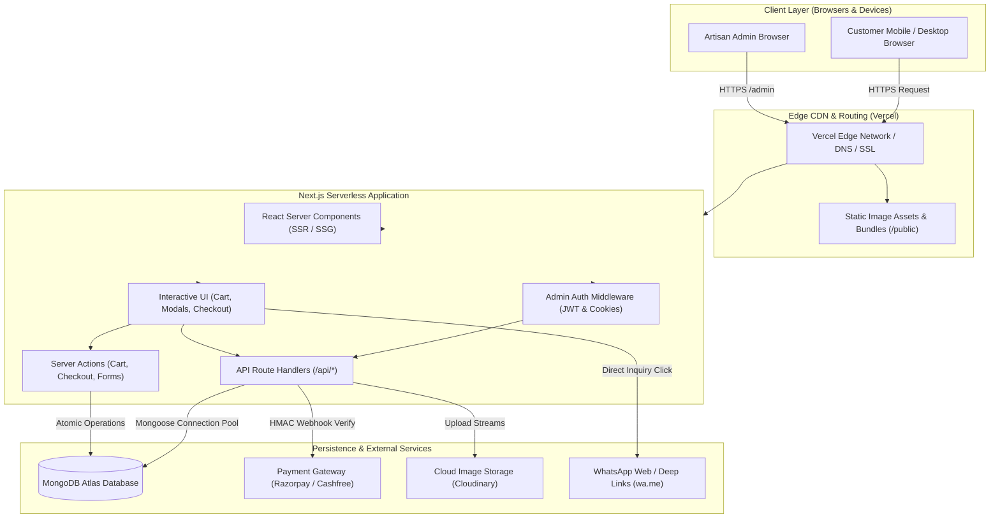
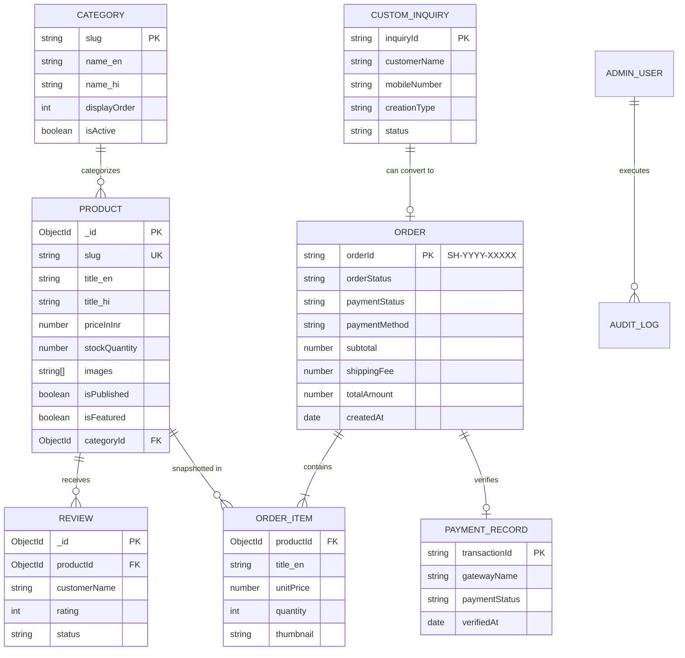
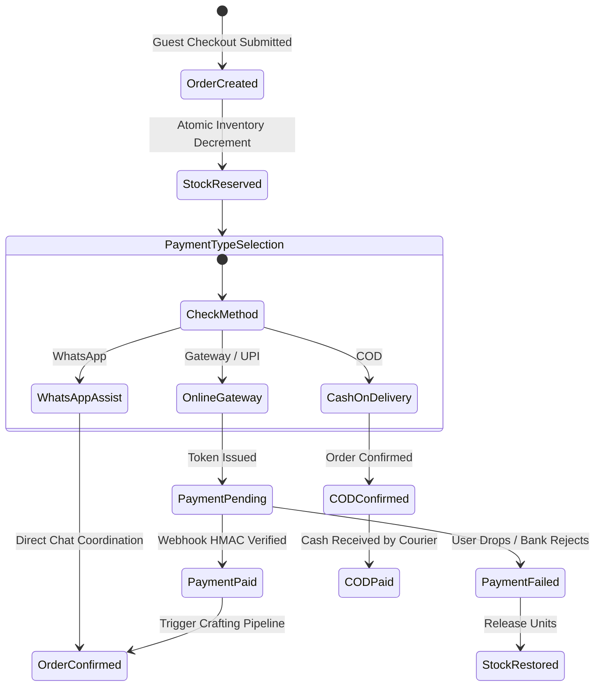

# TECHNICAL REQUIREMENTS DOCUMENT (TRD)
## Project: Sangita Handmade — Direct-to-Consumer (D2C) E-Commerce Platform

---

| **Document Attribute** | **Specification Details** |
| :--- | :--- |
| **Document Title** | Technical Requirements Document (TRD) — Sangita Handmade |
| **Document Version** | 1.0.0 (Architecture Baseline) |
| **Date** | October 14, 2026 |
| **Status** | Approved for Implementation Planning |
| **Author / Roles** | Senior Software Architect, Full-Stack Lead, Database Designer, Application Security Engineer |
| **Companion Document** | [`PRD.md`](file:///c:/Users/DELL/OneDrive/Documents/sangita%20handmade/PRD.md) (Product Requirements Document v1.0.0) |
| **Target Runtime** | Node.js (LTS v20+) / Next.js 14+ App Router / MongoDB Atlas / Vercel Serverless |

---

## 1. Purpose and Relationship to PRD.md

### 1.1 Purpose of this Document
The **Technical Requirements Document (TRD)** defines the complete engineering architecture, data schemas, API specifications, security protocols, integration workflows, and deployment infrastructure for **Sangita Handmade**. It translates the business, functional, and user-experience requirements established in [`PRD.md`](file:///c:/Users/DELL/OneDrive/Documents/sangita%20handmade/PRD.md) into concrete, testable technical designs.

### 1.2 Relationship to PRD.md
- **Single Source of Truth:** [`PRD.md`](file:///c:/Users/DELL/OneDrive/Documents/sangita%20handmade/PRD.md) remains the authoritative baseline for all business goals, product scopes, brand aesthetics, feature priorities (P0, P1, P2), and operational policies.
- **Strict Requirement Fidelity:** The TRD introduces no unauthorized feature creep. Unresolved commercial decisions identified in the PRD (such as the exact flat shipping rate, live payment gateway merchant selection, and actual business contact details) are preserved as configurable parameters and explicitly documented under [Section 29: Assumptions, Unresolved Decisions & Risks](#29-assumptions-unresolved-decisions-risks-and-dependencies).
- **Target Audience:** This document is designed for full-stack developers, software architects, code review agents, and technical stakeholders. Key concepts are explained clearly so that a beginner or apprentice engineer can comprehend both the *what* and the *why* of each architectural decision.

---

## 2. System Overview & Architectural Principles

### 2.1 Core Architectural Principles
1. **Serverless & Cost Efficiency:** Maintain zero standing infrastructure costs during idle periods by leveraging free-tier platforms (Vercel serverless edge functions and MongoDB Atlas M0).
2. **Defensive Concurrency & Atomic Operations:** Prevent inventory overselling on the last available handmade unit through database-level atomic conditional operations, ensuring zero split-brain inventory states.
3. **Decoupled Order and Payment Lifecycles:** Treat order placement and payment capture as separate state machines. An order can exist in an authorized, pending, or COD state without premature assumptions of financial settlement.
4. **Zero Trust on Client Data:** Never trust browser redirects, client-submitted prices, cart totals, or discount claims. All calculations, signature verifications, and inventory checks execute strictly on the server.
5. **No Ephemeral Storage Assumptions:** Because serverless environments run on read-only, ephemeral containers, file uploads (product images and customer reference photos) must utilize persistent cloud object storage or static project directories rather than local server disk writes.
6. **Graceful Degradation & Resilience:** External services (such as payment gateways, third-party courier lookups, and cloud storage) are insulated with fallback flows (e.g., COD fallback, direct WhatsApp order routing, and localized default assets).

---

## 3. Recommended Technology Stack & Decision Rationale

```
+----------------------------------------------------------------------------------------------------+
| SANGITA HANDMADE — FULL TECHNOLOGY STACK                                                           |
+----------------------------------------------------------------------------------------------------+
| Tier                 | Selected Technology                | Key Rationale                          |
| :------------------- | :--------------------------------- | :------------------------------------- |
| Frontend Framework   | Next.js (React 18/19, App Router)  | Hybrid SSR/SSG, fast SEO, server actions|
| Programming Language | TypeScript (Strict Mode)           | End-to-end type safety, fewer bugs     |
| Styling & Design     | Vanilla CSS + CSS Custom Properties| Brand token adherence, zero bloat      |
| Database & ODM       | MongoDB Atlas + Mongoose ODM       | Schema flexibility, nested order lines |
| Authentication       | Custom JWT in HttpOnly Cookie      | Stateless, zero-cost, brute-force lock |
| Password Hashing     | bcryptjs (12 salt rounds)          | Industry-standard cryptographic hashing |
| File & Image Storage | Cloudinary Free Tier / Local /public| Serverless-compatible persistent storage|
| Payment Gateway SDK  | Razorpay Node SDK (or Cashfree)    | RBI-compliant Indian UPI/Card support  |
| Hosting & CDN        | Vercel (Hobby / Serverless)        | Automated CI/CD, SSL, low-latency CDN  |
| Version Control      | Git & GitHub                       | Branch protection, automated deployments|
+----------------------------------------------------------------------------------------------------+
```

### 3.1 Language Decision: TypeScript (Strict Mode)
- **Decision:** Adopt **TypeScript** exclusively across the codebase (`tsconfig.json` with `"strict": true`).
- **Rationale:** An e-commerce platform processes delicate financial calculations, shipping structures, and decoupled order statuses. TypeScript eliminates entire classes of runtime errors (`TypeError: Cannot read properties of undefined`), enforces strict contracts between database models and API payloads, and provides self-documenting code for collaborating developers and AI coding agents.

### 3.2 Framework Decision: Next.js with App Router
- **Decision:** Utilize **Next.js with App Router** (`/app` directory convention).
- **Rationale:** 
  - Allows Server Components (RSC) for product catalogs, rendering fast, search-engine-crawlable HTML with zero client JavaScript penalty.
  - Colocates backend logic within Route Handlers (`route.ts`) and Server Actions without requiring a separate Express or Nest.js microservice.
  - Built-in `next/image` handles on-the-fly WebP conversion, responsive image scaling, and lazy loading.

### 3.3 Database Decision: MongoDB with Mongoose
- **Decision:** Utilize **MongoDB Atlas** paired with **Mongoose ODM**.
- **Rationale:** E-commerce order items are naturally hierarchical (an order contains an immutable snapshot array of product names, historical prices, and thumbnail URLs). MongoDB's document model avoids complex multi-table joins, while Mongoose provides strict schema validation, type definitions, and middleware hooks.

### 3.4 Styling Decision: Vanilla CSS with Design System Tokens
- **Decision:** Pure Vanilla CSS using CSS Modules (`*.module.css`) and global CSS variables (`globals.css`).
- **Rationale:** Aligns with project instructions to avoid unnecessary utility frameworks (like TailwindCSS) while offering complete control over the bespoke luxury aesthetic defined in [`PRD.md`](file:///c:/Users/DELL/OneDrive/Documents/sangita%20handmade/PRD.md) (`#FFF8EF`, `#722F3E`, `#C6A15B`).

---

## 4. High-Level System Architecture & Component Responsibilities

### 4.1 Architectural Diagram



### 4.2 Component Responsibilities
- **Vercel Edge Network:** Terminates TLS 1.3, caches static assets, applies security headers, and routes dynamic traffic to regional serverless lambda workers.
- **Next.js Server Components:** Fetches public catalog items, applies SEO metadata, and outputs pre-rendered HTML for fast First Contentful Paint (FCP).
- **Next.js Client Components:** Manages dynamic client state (cart drawer, quantity selectors, checkout validation, image zoom modals, and language toggle).
- **Middleware (`middleware.ts`):** Intercepts requests to `/admin/:path*` and `/api/admin/:path*`, validates the signed HTTP-only session token, and prevents unauthorized access.
- **MongoDB Atlas Cluster:** Houses all persistent application data with indexed collections and atomic write locking.

---

## 5. Frontend Architecture & UI Implementation

### 5.1 Route Hierarchy (App Router)

```
app/
├── [locale]/                          # Root localized layout segment (en / hi)
│   ├── layout.tsx                     # Global HTML structure, fonts, theme tokens
│   ├── page.tsx                       # Homepage (Hero, Categories, Featured, Craft Story)
│   ├── shop/
│   │   ├── page.tsx                   # Product catalog (Search, Filters, Sort)
│   │   └── [slug]/
│   │       └── page.tsx               # Product Detail Page (PDP)
│   ├── cart/
│   │   └── page.tsx                   # Full cart review page (fallback for drawer)
│   ├── checkout/
│   │   ├── page.tsx                   # Guest checkout form & address entry
│   │   └── confirmation/
│   │       └── [orderId]/
│   │           └── page.tsx           # Order success receipt & tracking link
│   ├── custom-order/
│   │   └── page.tsx                   # Bespoke order inquiry form with photo upload
│   ├── reviews/
│   │   └── page.tsx                   # Customer reviews showcase & submission form
│   ├── contact/
│   │   └── page.tsx                   # Contact Us form & studio contact details
│   ├── privacy-policy/
│   │   └── page.tsx                   # Legal: Privacy & data handling policy
│   ├── terms/
│   │   └── page.tsx                   # Legal: Terms and conditions
│   ├── shipping-policy/
│   │   └── page.tsx                   # Legal: Domestic Pan-India delivery policy
│   ├── cancellation-refunds/
│   │   └── page.tsx                   # Legal: Cancellation, replacement & refund rules
│   └── not-found.tsx                  # 404 Not Found luxury branded page
├── admin/                             # Isolated admin control panel
│   ├── login/
│   │   └── page.tsx                   # Admin credentials entry
│   ├── layout.tsx                     # Admin shell (Sidebar, Topbar, Session Context)
│   ├── page.tsx                       # Redirects to /admin/orders or /admin/dashboard
│   ├── dashboard/
│   │   └── page.tsx                   # Financial & operational sales summary
│   ├── products/
│   │   ├── page.tsx                   # Product catalog manager table
│   │   ├── new/
│   │   │   └── page.tsx               # Product creation form
│   │   └── [id]/
│   │       └── page.tsx               # Product edit form
│   ├── orders/
│   │   ├── page.tsx                   # Order registry with status filters
│   │   └── [id]/
│   │       └── page.tsx               # Detailed order inspector, tracking, notes
│   ├── custom-inquiries/
│   │   └── page.tsx                   # Bespoke requests queue & WhatsApp triggers
│   ├── reviews/
│   │   └── page.tsx                   # Review moderation (Approve / Reject queue)
│   └── settings/
│       └── page.tsx                   # Flat shipping fee & contact info settings
```

### 5.2 Global Design System Tokens (`globals.css`)
To satisfy the exact aesthetic requirements specified in [`PRD.md`](file:///c:/Users/DELL/OneDrive/Documents/sangita%20handmade/PRD.md), the application defines CSS custom variables at the root level:

```css
:root {
  /* Sangita Handmade Official Brand Palette */
  --color-cream: #FFF8EF;             /* Primary page & card background */
  --color-burgundy: #722F3E;          /* Primary accents, headings, brand actions */
  --color-gold: #C6A15B;              /* Badges, subtle borders, focus outlines */
  --color-charcoal: #1F1B18;          /* High-contrast body copy */
  --color-cream-subtle: #F3ECE1;      /* Secondary section fills & input backgrounds */
  --color-burgundy-hover: #5A2430;    /* Darkened burgundy for button hover states */
  --color-gold-hover: #B08D47;        /* Darkened gold for border interactions */
  --color-success: #2E6B44;           /* In-stock pill, payment success indicator */
  --color-error: #9B2226;             /* Form validation errors, stock alerts */

  /* Typography Scale */
  --font-serif: "Cormorant Garamond", Georgia, serif;
  --font-sans: "Montserrat", "Segoe UI", sans-serif;
  --font-indic: "Noto Sans Devanagari", sans-serif;

  /* Elevation Shadows & Transitions */
  --shadow-sm: 0 2px 6px rgba(114, 47, 62, 0.05);
  --shadow-md: 0 6px 16px rgba(114, 47, 62, 0.08);
  --shadow-lg: 0 12px 28px rgba(114, 47, 62, 0.12);
  --radius-sm: 4px;
  --radius-md: 8px;
  --radius-lg: 16px;
  --transition-fast: 150ms cubic-bezier(0.4, 0, 0.2, 1);
  --transition-smooth: 250ms cubic-bezier(0.4, 0, 0.2, 1);
}
```

### 5.3 Client State Management Strategy
To avoid heavy external state libraries (such as Redux or MobX), client state is partitioned into two lightweight, purposeful layers:
1. **Shopping Cart State (`CartContext.tsx`):**
   - Implemented via React Context + `useReducer`.
   - Synchronized automatically to `window.localStorage` under the key `sangita_cart_v1`.
   - Contains item actions: `ADD_ITEM`, `REMOVE_ITEM`, `UPDATE_QUANTITY`, `CLEAR_CART`.
   - Encapsulates stock boundary validation (cannot increment beyond available stock).
2. **Localization State (`LocaleContext.tsx`):**
   - Reads active locale from URL segment (`/en/...` or `/hi/...`) and cookie `NEXT_LOCALE`.
   - Provides translation helper function `t(key)` loaded from lightweight JSON dictionaries (`/messages/en.json` and `/messages/hi.json`).

---

## 6. Backend Architecture & API Specifications

### 6.1 API Conventions
- All backend routes reside under `/api/*`.
- Standard JSON response envelope format:
  ```typescript
  interface ApiResponse<T> {
    success: boolean;
    data?: T;
    error?: {
      code: string;
      message: string;
      details?: Record<string, string>;
    };
  }
  ```
- **HTTP Status Codes:**
  - `200 OK`: Request succeeded.
  - `201 Created`: Resource successfully created (order placed, inquiry submitted).
  - `400 Bad Request`: Input validation failed (invalid phone number, malformed payload).
  - `401 Unauthorized`: Missing or invalid authentication token.
  - `403 Forbidden`: Authenticated user lacks permission.
  - `404 Not Found`: Entity (product slug, order ID) does not exist.
  - `409 Conflict`: Concurrency conflict (e.g., product sold out while placing order).
  - `429 Too Many Requests`: Rate limit exceeded.
  - `500 Internal Server Error`: Unhandled server exception (logged securely).

### 6.2 Public API Endpoints

```
+----------------------------------------------------------------------------------------------------+
| PUBLIC API ENDPOINTS SPECIFICATION                                                                 |
+----------------------------------------------------------------------------------------------------+
| Route Path                | Method | Input / Validation            | Purpose / Output              |
| :------------------------ | :----: | :---------------------------- | :---------------------------- |
| /api/products             | GET    | ?category, ?minPrice, ?maxPrice,| Returns paginated list of    |
|                           |        | ?inStock=true, ?search        | active published products     |
| /api/products/[slug]      | GET    | slug in URL                   | Returns full product detail   |
| /api/categories           | GET    | None                          | Returns active categories     |
| /api/checkout/validate    | POST   | { items: [{ id, qty }] }       | Verifies current stock & price|
| /api/orders               | POST   | Full guest checkout payload   | Creates order & reserves stock|
| /api/orders/[orderId]     | GET    | orderId in URL + mobile query | Returns order status & AWB    |
| /api/payments/create-intent| POST  | { orderId }                   | Creates gateway transaction ID|
| /api/payments/verify      | POST   | { orderId, paymentId, sig }   | Verifies gateway HMAC signature|
| /api/payments/webhook     | POST   | Raw gateway webhook payload   | Idempotent server webhook     |
| /api/custom-inquiry       | POST   | FormData (fields + photo)     | Submits bespoke order inquiry |
| /api/reviews              | POST   | { productId, rating, text... }| Submits review (pending)      |
| /api/contact              | POST   | { name, email, message }      | Logs customer inquiry message |
+----------------------------------------------------------------------------------------------------+
```

### 6.3 Protected Admin API Endpoints

```
+----------------------------------------------------------------------------------------------------+
| PROTECTED ADMIN API ENDPOINTS SPECIFICATION (Requires Admin JWT Cookie)                            |
+----------------------------------------------------------------------------------------------------+
| Route Path                     | Method | Purpose                                                  |
| :----------------------------- | :----: | :------------------------------------------------------- |
| /api/admin/auth/login          | POST   | Authenticates username/password; sets HttpOnly cookie     |
| /api/admin/auth/logout         | POST   | Clears session cookie                                    |
| /api/admin/auth/me             | GET    | Verifies current admin session identity                  |
| /api/admin/products            | POST   | Creates new product with photos and stock                |
| /api/admin/products/[id]       | PUT    | Updates existing product fields, prices, or stock        |
| /api/admin/products/[id]       | DELETE | Soft-archives / deletes product                          |
| /api/admin/orders              | GET    | Returns filtered list of customer orders                 |
| /api/admin/orders/[id]/status  | PATCH  | Updates order status (e.g., CONFIRMED -> DISPATCHED)      |
| /api/admin/orders/[id]/tracking| PATCH  | Attaches courier partner name, tracking AWB, and URL      |
| /api/admin/orders/[id]/notes   | PATCH  | Updates internal artisan studio notes                    |
| /api/admin/custom-inquiries    | GET    | Lists bespoke order inquiries                            |
| /api/admin/reviews             | GET    | Lists pending and moderated reviews                      |
| /api/admin/reviews/[id]/status | PATCH  | Approves or rejects customer review                      |
| /api/admin/reports/sales       | GET    | Returns aggregated gross sales, collected cash & counts   |
| /api/admin/settings            | GET/PUT| Retrieves and updates flat shipping fee & store contacts  |
+----------------------------------------------------------------------------------------------------+
```

---

## 7. Database Architecture & Mongoose Schema Design

All application models reside in the MongoDB database. Schemas are defined in TypeScript using Mongoose.

### 7.1 Entity-Relationship Diagram



---

### 7.2 Detailed Mongoose Schemas

#### 1. Product Model (`models/Product.ts`)
```typescript
import mongoose, { Schema, Document, Types } from "mongoose";

export interface IProduct extends Document {
  title_en: string;
  title_hi: string;
  slug: string;
  description_en: string;
  description_hi: string;
  priceInInr: number;
  stockQuantity: number;
  images: string[];
  categoryId: Types.ObjectId;
  isPublished: boolean;
  isFeatured: boolean;
  materials_en?: string;
  materials_hi?: string;
  dimensions_en?: string;
  dimensions_hi?: string;
  careGuide_en?: string;
  careGuide_hi?: string;
  createdAt: Date;
  updatedAt: Date;
}

const ProductSchema = new Schema<IProduct>(
  {
    title_en: { type: String, required: true, trim: true },
    title_hi: { type: String, required: true, trim: true },
    slug: { type: String, required: true, unique: true, lowercase: true, trim: true, index: true },
    description_en: { type: String, required: true },
    description_hi: { type: String, required: true },
    priceInInr: { type: Number, required: true, min: 0 },
    stockQuantity: { type: Number, required: true, min: 0, default: 0 },
    images: { type: [String], required: true, validate: [(val: string[]) => val.length > 0, "At least 1 image required"] },
    categoryId: { type: Schema.Types.ObjectId, ref: "Category", required: true, index: true },
    isPublished: { type: Boolean, default: false, index: true },
    isFeatured: { type: Boolean, default: false, index: true },
    materials_en: { type: String },
    materials_hi: { type: String },
    dimensions_en: { type: String },
    dimensions_hi: { type: String },
    careGuide_en: { type: String },
    careGuide_hi: { type: String }
  },
  { timestamps: true }
);

// Compound index for catalog filtering & sorting
ProductSchema.index({ isPublished: 1, categoryId: 1, priceInInr: 1 });
ProductSchema.index({ isPublished: 1, isFeatured: 1 });
```

#### 2. Order Model (`models/Order.ts`)
The order document contains an **embedded snapshot** of the order lines. This guarantees that future price updates or product deletions will never alter the historical truth of past transactions.

```typescript
import mongoose, { Schema, Document } from "mongoose";

export interface IOrderItem {
  productId: mongoose.Types.ObjectId;
  title_en: string;
  title_hi: string;
  slug: string;
  unitPrice: number;
  quantity: number;
  thumbnail: string;
  lineTotal: number;
}

export interface IOrder extends Document {
  orderId: string; // Unique format: SH-YYYY-XXXXX
  customer: {
    fullName: string;
    mobileNumber: string;
    email?: string;
    address: {
      houseStreet: string;
      localityArea: string;
      city: string;
      state: string;
      pinCode: string;
    };
    deliveryInstructions?: string;
  };
  items: IOrderItem[];
  subtotal: number;
  shippingFee: number;
  totalAmount: number;
  orderStatus: "PENDING" | "CONFIRMED" | "PROCESSING" | "DISPATCHED" | "DELIVERED" | "CANCELLED" | "RETURNED";
  paymentStatus: "PENDING" | "PAID" | "FAILED" | "PENDING_COD" | "REFUNDED";
  paymentMethod: "GATEWAY" | "UPI_QR" | "COD" | "WHATSAPP";
  paymentDetails?: {
    gatewayName?: string;
    transactionId?: string;
    paymentId?: string;
    signatureVerified?: boolean;
    paidAt?: Date;
  };
  courierDetails?: {
    partnerName?: string;
    trackingAwb?: string;
    trackingUrl?: string;
    dispatchedAt?: Date;
  };
  adminNotes?: string;
  createdAt: Date;
  updatedAt: Date;
}

const OrderItemSchema = new Schema<IOrderItem>(
  {
    productId: { type: Schema.Types.ObjectId, ref: "Product", required: true },
    title_en: { type: String, required: true },
    title_hi: { type: String, required: true },
    slug: { type: String, required: true },
    unitPrice: { type: Number, required: true, min: 0 },
    quantity: { type: Number, required: true, min: 1 },
    thumbnail: { type: String, required: true },
    lineTotal: { type: Number, required: true, min: 0 }
  },
  { _id: false }
);

const OrderSchema = new Schema<IOrder>(
  {
    orderId: { type: String, required: true, unique: true, index: true },
    customer: {
      fullName: { type: String, required: true, trim: true },
      mobileNumber: { type: String, required: true, match: /^[6-9]\d{9}$/ },
      email: { type: String, trim: true, lowercase: true },
      address: {
        houseStreet: { type: String, required: true },
        localityArea: { type: String, required: true },
        city: { type: String, required: true },
        state: { type: String, required: true },
        pinCode: { type: String, required: true, match: /^[1-9][0-9]{5}$/ }
      },
      deliveryInstructions: { type: String, maxlength: 300 }
    },
    items: { type: [OrderItemSchema], required: true, validate: [(val: any[]) => val.length > 0, "Order must have items"] },
    subtotal: { type: Number, required: true, min: 0 },
    shippingFee: { type: Number, required: true, min: 0 },
    totalAmount: { type: Number, required: true, min: 0 },
    orderStatus: {
      type: String,
      enum: ["PENDING", "CONFIRMED", "PROCESSING", "DISPATCHED", "DELIVERED", "CANCELLED", "RETURNED"],
      default: "PENDING",
      index: true
    },
    paymentStatus: {
      type: String,
      enum: ["PENDING", "PAID", "FAILED", "PENDING_COD", "REFUNDED"],
      default: "PENDING",
      index: true
    },
    paymentMethod: {
      type: String,
      enum: ["GATEWAY", "UPI_QR", "COD", "WHATSAPP"],
      required: true
    },
    paymentDetails: {
      gatewayName: String,
      transactionId: { type: String, index: true, sparse: true },
      paymentId: String,
      signatureVerified: { type: Boolean, default: false },
      paidAt: Date
    },
    courierDetails: {
      partnerName: String,
      trackingAwb: String,
      trackingUrl: String,
      dispatchedAt: Date
    },
    adminNotes: String
  },
  { timestamps: true }
);

// Indexes for order lookup and reporting
OrderSchema.index({ "customer.mobileNumber": 1 });
OrderSchema.index({ createdAt: -1 });
OrderSchema.index({ orderStatus: 1, paymentStatus: 1 });
```

#### 3. Custom Order Inquiry Model (`models/CustomInquiry.ts`)
```typescript
import mongoose, { Schema, Document } from "mongoose";

export interface ICustomInquiry extends Document {
  inquiryId: string; // Format: CI-YYYY-XXXXX
  customerName: string;
  mobileNumber: string;
  creationType: string;
  occasion?: string;
  colorNotes: string;
  budgetRange?: string;
  deliveryDeadline: Date;
  referenceImageUrl?: string;
  additionalNotes?: string;
  status: "ENQUIRY_RECEIVED" | "CONTACTED" | "QUOTED" | "CONVERTED_TO_ORDER" | "DECLINED";
  adminNotes?: string;
  createdAt: Date;
  updatedAt: Date;
}

const CustomInquirySchema = new Schema<ICustomInquiry>(
  {
    inquiryId: { type: String, required: true, unique: true, index: true },
    customerName: { type: String, required: true, trim: true },
    mobileNumber: { type: String, required: true, match: /^[6-9]\d{9}$/ },
    creationType: { type: String, required: true },
    occasion: String,
    colorNotes: { type: String, required: true },
    budgetRange: String,
    deliveryDeadline: { type: Date, required: true },
    referenceImageUrl: String,
    additionalNotes: String,
    status: {
      type: String,
      enum: ["ENQUIRY_RECEIVED", "CONTACTED", "QUOTED", "CONVERTED_TO_ORDER", "DECLINED"],
      default: "ENQUIRY_RECEIVED",
      index: true
    },
    adminNotes: String
  },
  { timestamps: true }
);
```

#### 4. Review Model (`models/Review.ts`)
```typescript
import mongoose, { Schema, Document, Types } from "mongoose";

export interface IReview extends Document {
  productId: Types.ObjectId;
  customerName: string;
  rating: number; // 1 to 5
  reviewText: string;
  photoUrl?: string;
  status: "PENDING_APPROVAL" | "APPROVED" | "REJECTED";
  createdAt: Date;
  updatedAt: Date;
}

const ReviewSchema = new Schema<IReview>(
  {
    productId: { type: Schema.Types.ObjectId, ref: "Product", required: true, index: true },
    customerName: { type: String, required: true, trim: true },
    rating: { type: Number, required: true, min: 1, max: 5 },
    reviewText: { type: String, required: true, trim: true, maxlength: 1000 },
    photoUrl: String,
    status: {
      type: String,
      enum: ["PENDING_APPROVAL", "APPROVED", "REJECTED"],
      default: "PENDING_APPROVAL",
      index: true
    }
  },
  { timestamps: true }
);

ReviewSchema.index({ productId: 1, status: 1 });
```

#### 5. Admin User Model (`models/AdminUser.ts`)
```typescript
import mongoose, { Schema, Document } from "mongoose";

export interface IAdminUser extends Document {
  username: string;
  passwordHash: string;
  role: "SUPER_ADMIN" | "STUDIO_ARTISAN";
  failedAttempts: number;
  lockUntil?: Date;
  lastLoginAt?: Date;
  createdAt: Date;
  updatedAt: Date;
}

const AdminUserSchema = new Schema<IAdminUser>(
  {
    username: { type: String, required: true, unique: true, lowercase: true, trim: true },
    passwordHash: { type: String, required: true },
    role: { type: String, enum: ["SUPER_ADMIN", "STUDIO_ARTISAN"], default: "SUPER_ADMIN" },
    failedAttempts: { type: Number, default: 0 },
    lockUntil: Date,
    lastLoginAt: Date
  },
  { timestamps: true }
);
```

#### 6. Store Settings Model (`models/StoreSettings.ts`)
```typescript
import mongoose, { Schema, Document } from "mongoose";

export interface IStoreSettings extends Document {
  flatShippingFee: number;
  freeShippingThreshold?: number; // Optional threshold (e.g. Free above ₹1,999)
  storePhonePlaceholder: string;
  storeEmailPlaceholder: string;
  storeAddressPlaceholder: string;
  instagramUrlPlaceholder: string;
  updatedAt: Date;
}

const StoreSettingsSchema = new Schema<IStoreSettings>(
  {
    flatShippingFee: { type: Number, required: true, default: 99, min: 0 },
    freeShippingThreshold: { type: Number, min: 0 },
    storePhonePlaceholder: { type: String, default: "[BUSINESS_WHATSAPP]" },
    storeEmailPlaceholder: { type: String, default: "[BUSINESS_EMAIL]" },
    storeAddressPlaceholder: { type: String, default: "[BUSINESS_ADDRESS]" },
    instagramUrlPlaceholder: { type: String, default: "[INSTAGRAM_URL]" }
  },
  { timestamps: true }
);
```

---

## 8. Authentication, Authorization & Admin Protection

### 8.1 Admin Authentication Mechanism
The admin dashboard is protected via an **encrypted, stateless JSON Web Token (JWT)** stored in an `HttpOnly`, `Secure`, `SameSite=Strict` cookie.

```
+----------------------------------------------------------------------------------------------------+
| ADMIN AUTHENTICATION FLOW                                                                          |
+----------------------------------------------------------------------------------------------------+
| 1. Admin navigates to /admin/login and enters username and password.                               |
| 2. Server Action / API verifies brute-force lockout: if lockUntil > Date.now(), return 429.        |
| 3. bcryptjs.compare(submittedPassword, adminRecord.passwordHash) is executed.                     |
| 4. On failure: increment failedAttempts. If >= 5, set lockUntil = Date.now() + 15 minutes.        |
| 5. On success: reset failedAttempts; sign JWT token with ADMIN_JWT_SECRET (expiry: 8 hours).       |
| 6. Server sets cookie: "admin_token", httpOnly: true, secure: true, sameSite: "strict", path: "/".|
| 7. Browser redirects to /admin/orders.                                                             |
+----------------------------------------------------------------------------------------------------+
```

### 8.2 Route Protection via Next.js Edge Middleware (`middleware.ts`)
```typescript
import { NextResponse } from "next/server";
import type { NextRequest } from "next/server";
import { jwtVerify } from "jose"; // Lightweight edge-compatible JWT library

export async function middleware(request: NextRequest) {
  const { pathname } = request.nextUrl;

  // Intercept all /admin (except /admin/login) and all /api/admin (except /api/admin/auth/login)
  const isProtectedAdminPage = pathname.startsWith("/admin") && !pathname.startsWith("/admin/login");
  const isProtectedAdminApi = pathname.startsWith("/api/admin") && !pathname.startsWith("/api/admin/auth/login");

  if (isProtectedAdminPage || isProtectedAdminApi) {
    const token = request.cookies.get("admin_token")?.value;

    if (!token) {
      if (isProtectedAdminApi) {
        return NextResponse.json({ success: false, error: { code: "UNAUTHORIZED", message: "Admin authentication required" } }, { status: 401 });
      }
      return NextResponse.redirect(new URL("/admin/login", request.url));
    }

    try {
      const secret = new TextEncoder().encode(process.env.ADMIN_JWT_SECRET);
      await jwtVerify(token, secret);
      return NextResponse.next();
    } catch (err) {
      // Token invalid or expired
      if (isProtectedAdminApi) {
        return NextResponse.json({ success: false, error: { code: "TOKEN_EXPIRED", message: "Session expired. Re-login required" } }, { status: 401 });
      }
      return NextResponse.redirect(new URL("/admin/login", request.url));
    }
  }

  return NextResponse.next();
}

export const config = {
  matcher: ["/admin/:path*", "/api/admin/:path*"]
};
```

---

## 9. Inventory Reservation, Concurrency & Stock Restoration

### 9.1 The Concurrency Problem
If two customers attempt to purchase the single remaining handcrafted bouquet simultaneously, a naive `find() -> check -> save()` workflow suffers from a **race condition** where both orders succeed, causing severe overselling.

### 9.2 Atomic Decrement Strategy (Zero Overselling Guarantee)
To prevent overselling without requiring complex multi-document distributed lock managers, the application executes **MongoDB Atomic Conditional Updates**:

```typescript
// Atomically reserve inventory for an order item
const updatedProduct = await Product.findOneAndUpdate(
  {
    _id: item.productId,
    stockQuantity: { $gte: item.quantity } // Precondition: Stock must be sufficient
  },
  {
    $inc: { stockQuantity: -item.quantity } // Atomic decrement
  },
  { new: true }
);

if (!updatedProduct) {
  // Concurrency conflict: Someone bought the unit a split second prior
  throw new Error(`Insufficient stock for product ${item.productId}`);
}
```

### 9.3 Inventory Restoration Rules
Inventory must be restored immediately under the following verified conditions:
1. **Online Payment Cancellation or Expiry:** If an order remains in `paymentStatus: "PENDING"` for $> 30$ minutes without gateway confirmation, a background cleanup job or on-demand check marks the order `EXPIRED` and issues `$inc: { stockQuantity: +quantity }`.
2. **Pre-Dispatch Order Cancellation:** When an admin marks an unfulfilled order as `CANCELLED`, the system iterates over the order items snapshot and atomically increments product stock.

---

## 10. Payment Gateway Integration & Webhook Idempotency

### 10.1 Decoupled Order and Payment Lifecycle
As mandated by [`PRD.md`](file:///c:/Users/DELL/OneDrive/Documents/sangita%20handmade/PRD.md), Order Status and Payment Status are decoupled:



### 10.2 Server-Side Gateway Verification & Webhook Handling
- **Never Trust Client Redirects:** A browser redirect from Razorpay or Cashfree cannot be used as proof of payment. Payment status is only updated after the server executes an HMAC-SHA256 signature verification.

#### HMAC-SHA256 Signature Verification Implementation
```typescript
import crypto from "crypto";

export function verifyGatewaySignature(
  orderId: string,
  paymentId: string,
  signature: string,
  secret: string
): boolean {
  const generatedSignature = crypto
    .createHmac("sha256", secret)
    .update(`${orderId}|${paymentId}`)
    .digest("hex");

  return crypto.timingSafeEqual(
    Buffer.from(generatedSignature, "utf-8"),
    Buffer.from(signature, "utf-8")
  );
}
```

### 10.3 Webhook Idempotency Architecture
Payment gateways retry webhooks multiple times if an acknowledgment (HTTP 200) is delayed. The webhook handler (`/api/payments/webhook`) ensures idempotency:
1. Inspect the incoming `payload.payment.id`.
2. Query `Order.findOne({ "paymentDetails.transactionId": paymentId })`.
3. If an existing order is already marked `paymentStatus: "PAID"`, immediately return `HTTP 200 { success: true, message: "Already processed" }` without decrementing stock or sending duplicate alerts.
4. If not yet processed, verify signature, transition `paymentStatus` to `"PAID"`, transition `orderStatus` to `"CONFIRMED"`, and record `paidAt: new Date()`.

---

## 11. Alternative Payment Methods: UPI/QR, COD & WhatsApp

### 11.1 Cash on Delivery (COD) Workflow
1. User selects "Cash on Delivery" at checkout.
2. System validates address, validates 10-digit mobile number, and reserves inventory.
3. Order record created with:
   - `orderStatus: "CONFIRMED"`
   - `paymentStatus: "PENDING_COD"`
   - `paymentMethod: "COD"`
4. Order Confirmation page warns customer: *"Please keep exact cash (₹[Total]) ready for the courier partner upon parcel arrival."*
5. Admin verifies order; after courier delivery and cash collection, admin manually updates payment status to `"PAID"`.

### 11.2 Direct WhatsApp-Assisted Order Workflow
1. User clicks "Confirm & Pay via WhatsApp" on checkout or product page.
2. System creates a draft order record with `orderId: SH-YYYY-XXXXX`.
3. System generates a direct WhatsApp link (`https://wa.me/[BUSINESS_WHATSAPP]?text=...`):
   ```
   "Hello Sangita Handmade! I would like to confirm my order SH-2026-10482 for Lavender Dreams Bouquet (Qty: 1, Total: ₹1,998 incl. shipping). My name is Pooja Sharma, Bengaluru."
   ```
4. Artisan Sangita receives the structured message on WhatsApp, coordinates UPI QR payment or bank transfer directly, and updates the order status in the admin dashboard.

---

## 12. Product Image & File Upload Architecture

### 12.1 Local Development vs. Production Serverless Constraints
- **Local Development:** Static sample images reside in `/public/images/products/` and are referenced as relative paths (e.g., `/images/products/lavender-bouquet.webp`).
- **Production Ephemeral Filesystem Problem:** Vercel serverless functions run on read-only containers. Files saved to the local disk vanish as soon as the function terminates.
- **Production Architecture Decision:** 
  - Utilize **Cloudinary Free Tier** (or AWS S3 / Supabase Storage free tier) for all dynamic uploads (product photos added via admin and customer reference photos submitted on custom order forms).
  - Images are uploaded via an API route stream, optimized on Cloudinary, and the persistent secure URL (`https://res.cloudinary.com/...`) is saved in MongoDB.

### 12.2 File Upload Validation Pipeline
```
+----------------------------------------------------------------------------------------------------+
| SECURE FILE UPLOAD PIPELINE                                                                        |
+----------------------------------------------------------------------------------------------------+
| 1. Client selects image file (Max size: 5MB).                                                      |
| 2. Client-side check validates extension (.jpg, .jpeg, .png, .webp).                               |
| 3. POST to /api/upload with FormData payload.                                                      |
| 4. Server inspects file buffer magic bytes (ensures file is genuinely an image, not a binary/exe).|
| 5. If invalid MIME type: Return 400 Bad Request ("Only JPG, PNG, and WebP images allowed").       |
| 6. Server sanitizes filename: Generates UUID filename (e.g., "prod_8f93b2a1.webp").                |
| 7. Streams buffer to Cloud Storage / Cloudinary.                                                   |
| 8. Returns secure HTTPS URL to admin client for database persistence.                              |
+----------------------------------------------------------------------------------------------------+
```

---

## 13. Localization Architecture (English & Hindi)

### 13.1 Translation Strategy
To satisfy [`PRD.md`](file:///c:/Users/DELL/OneDrive/Documents/sangita%20handmade/PRD.md) requirements for seamless English and Hindi switching without third-party translation network lag:
1. **Static UI Strings:** Maintained in JSON dictionaries:
   - `/messages/en.json`: English interface strings.
   - `/messages/hi.json`: Hindi interface strings.
2. **Dynamic Database Fields:** The `Product` and `Category` Mongoose models store dual fields:
   - `title_en` and `title_hi`
   - `description_en` and `description_hi`
   - `materials_en` and `materials_hi`
3. **Locale Resolution Hierarchy:**
   - Active URL prefix: `/[locale]/...` (`en` or `hi`).
   - Cookie fallback: `NEXT_LOCALE`.
   - Browser header fallback: `Accept-Language`.
   - Default: `en`.
4. **Client Language Switcher:** A prominent toggle in the header (`EN | HI`) switches the route segment while preserving current search parameters, filter state, and cart contents.

---

## 14. Validation, Error Handling & Abuse Prevention

### 14.1 Server-Side Validation Matrix

| Field | Validation Rule / Regex | Error Response Message |
| :--- | :--- | :--- |
| **Mobile Number** | `^[6-9]\d{9}$` (Strict 10 digits starting 6–9) | "Please enter a valid 10-digit Indian mobile number." |
| **PIN Code** | `^[1-9][0-9]{5}$` (Strict 6 digits, cannot start with 0) | "Please enter a valid 6-digit Indian PIN code." |
| **Customer Name** | String, trim, length between 3 and 70 characters | "Please enter your full name (minimum 3 characters)." |
| **Street Address** | String, trim, length between 5 and 150 characters | "Please provide your complete house and street address." |
| **Product Quantity** | Integer, $\ge 1$ and $\le$ current product stock | "Selected quantity exceeds available stock." |
| **Custom Order Date**| ISO Date $\ge \text{Today} + 7\text{ calendar days}$ | "Custom orders require at least 7 days crafting notice." |

### 14.2 Rate Limiting & Abuse Prevention
To prevent bot-driven spam and payment gateway card-testing attacks, the platform implements rate limiting on critical endpoints:
- **/api/admin/auth/login:** 5 attempts per 15 minutes per IP address.
- **/api/orders:** 10 requests per 10 minutes per IP address.
- **/api/custom-inquiry:** 5 submissions per hour per IP address.
- **/api/reviews:** 3 submissions per hour per IP address.

---

## 15. Security, Privacy & Customer Data Protection

### 15.1 PCI DSS & Financial Data Security
- **Strict Prohibition:** The platform never touches, transmits, logs, or stores raw payment card numbers, CVVs, expiry dates, or UPI PINs.
- All checkout interfaces load tokenized SDK scripts directly from RBI-authorized aggregators.
- All API communication occurs exclusively over HTTPS/TLS 1.3 with HSTS enabled.

### 15.2 Cross-Site Scripting (XSS) & Injection Defense
- React automatically escapes variables rendered in JSX, preventing standard DOM-based XSS.
- User-supplied inputs (customer notes, reviews, inquiries) are stripped of HTML tags using an input sanitization library before saving to MongoDB.
- Mongoose schema typing prevents NoSQL query operator injection (`$gt`, `$ne`).

### 15.3 HTTP Security Headers (`next.config.js`)
```javascript
const securityHeaders = [
  { key: "X-DNS-Prefetch-Control", value: "on" },
  { key: "Strict-Transport-Security", value: "max-age=63072000; includeSubDomains; preload" },
  { key: "X-XSS-Protection", value: "1; mode=block" },
  { key: "X-Frame-Options", value: "SAMEORIGIN" },
  { key: "X-Content-Type-Options", value: "nosniff" },
  { key: "Referrer-Policy", value: "origin-when-cross-origin" }
];
```

---

## 16. Environment Variables Specification

The project distinguishes between public variables (prefixed with `NEXT_PUBLIC_`) and strictly private, server-only secrets.

### 16.1 `.env.example` Specification

```bash
# ===================================================================
# SANGITA HANDMADE — ENVIRONMENT CONFIGURATION TEMPLATE
# DO NOT COMMIT REAL VALUES TO VERSION CONTROL
# ===================================================================

# 1. DATABASE CONFIGURATION (MongoDB Atlas)
MONGODB_URI="mongodb+srv://<username>:<password>@cluster0.example.mongodb.net/sangita_handmade?retryWrites=true&w=majority"

# 2. APPLICATION RUNTIME URL
NEXT_PUBLIC_APP_URL="http://localhost:3000"

# 3. ADMIN AUTHENTICATION SECRET
# Generate using: openssl rand -base64 32
ADMIN_JWT_SECRET="replace-with-a-secure-32-byte-random-string"
ADMIN_DEFAULT_USERNAME="admin"
ADMIN_DEFAULT_PASSWORD="replace-with-a-strong-initial-password"

# 4. PAYMENT GATEWAY (Razorpay / Cashfree)
# Test credentials for local development; live credentials for production
NEXT_PUBLIC_PAYMENT_GATEWAY_KEY="rzp_test_placeholder_key"
PAYMENT_GATEWAY_SECRET="replace_with_payment_provider_secret"
PAYMENT_WEBHOOK_SECRET="replace_with_payment_webhook_signing_secret"

# 5. PERSISTENT CLOUD IMAGE STORAGE (Cloudinary)
CLOUDINARY_CLOUD_NAME="placeholder-cloud-name"
CLOUDINARY_API_KEY="placeholder-api-key"
CLOUDINARY_API_SECRET="placeholder-api-secret"

# 6. BUSINESS CONTACT PLACEHOLDERS (Matches PRD.md until owner confirmation)
NEXT_PUBLIC_BUSINESS_WHATSAPP="+919876543210"
NEXT_PUBLIC_BUSINESS_EMAIL="contact@sangitahandmade.com"
NEXT_PUBLIC_BUSINESS_ADDRESS="Studio Sangita, Craft Street, India"
NEXT_PUBLIC_INSTAGRAM_URL="https://instagram.com/sangitahandmade"

# 7. LOGISTICS & SHIPPING CONFIGURATION
NEXT_PUBLIC_DEFAULT_FLAT_SHIPPING_FEE="99"
```

---

## 17. Local Development Setup & Project Structure

### 17.1 Recommended Directory Tree

```
sangita-handmade/
├── .env.example                       # Documented environment variable template
├── .gitignore                         # Strict git exclusions (node_modules, .env*)
├── next.config.js                     # Next.js optimization & security headers
├── package.json                       # Dependencies & build scripts
├── tsconfig.json                      # TypeScript strict configuration
├── middleware.ts                      # Edge auth guard for /admin routes
├── PRD.md                             # Authoritative Product Requirements Document
├── TRD.md                             # Technical Requirements Document (This file)
├── public/                            # Static public web assets
│   ├── favicon.ico
│   ├── logo.svg
│   └── images/
│       ├── brand/                     # Studio banners & craftsmanship illustrations
│       └── products/                  # Initial local product photography
├── messages/                          # Localization dictionary files
│   ├── en.json                        # English UI translation strings
│   └── hi.json                        # Hindi UI translation strings
├── lib/                               # Core backend utilities & singletons
│   ├── db.ts                          # Cached MongoDB Mongoose connection handler
│   ├── auth.ts                        # JWT token generation & verification helpers
│   ├── utils.ts                       # Currency formatters, slugifiers, sanitizers
│   └── paymentGateway.ts              # Gateway client & HMAC verification logic
├── models/                            # Mongoose database schema models
│   ├── Product.ts
│   ├── Category.ts
│   ├── Order.ts
│   ├── CustomInquiry.ts
│   ├── Review.ts
│   ├── AdminUser.ts
│   └── StoreSettings.ts
├── context/                           # React Context providers (Cart, Locale)
│   ├── CartContext.tsx
│   └── LocaleContext.tsx
├── components/                        # Modular, reusable UI components
│   ├── layout/                        # Header, Navigation, Footer, DrawerCart
│   ├── ui/                            # Buttons, Inputs, Modals, BadgePills
│   ├── shop/                          # ProductCard, PriceFilter, GalleryViewer
│   ├── custom-order/                  # Bespoke inquiry form components
│   └── admin/                         # Sidebar, DataTable, StatCard, ImageUpload
└── app/                               # Next.js App Router route hierarchy
    ├── globals.css                    # Design system tokens & base typography
    ├── [locale]/                      # Public localized storefront pages
    └── admin/                         # Protected admin management dashboard
```

### 17.2 Database Connection Singleton (`lib/db.ts`)
To prevent serverless lambda functions from spawning hundreds of open database connections upon every invocation, Mongoose implements a global cached connection pool:

```typescript
import mongoose from "mongoose";

const MONGODB_URI = process.env.MONGODB_URI;

if (!MONGODB_URI) {
  throw new Error("Please define the MONGODB_URI environment variable inside .env.local");
}

let cached = (global as any).mongoose;

if (!cached) {
  cached = (global as any).mongoose = { conn: null, promise: null };
}

export async function connectToDatabase() {
  if (cached.conn) {
    return cached.conn;
  }

  if (!cached.promise) {
    const opts = {
      bufferCommands: false,
      maxPoolSize: 10 // Safe connection pool size for serverless free tier
    };

    cached.promise = mongoose.connect(MONGODB_URI!, opts).then((mongooseInstance) => {
      return mongooseInstance;
    });
  }

  try {
    cached.conn = await cached.promise;
  } catch (e) {
    cached.promise = null;
    throw e;
  }

  return cached.conn;
}
```

---

## 18. External Integrations & Prerequisite Matrix

```
+----------------------------------------------------------------------------------------------------+
| EXTERNAL SERVICE INTEGRATION PREREQUISITE MATRIX                                                   |
+----------------------------------------------------------------------------------------------------+
| External Service   | Role in System           | Local Dev Status    | Production Prerequisite      |
| :----------------- | :----------------------- | :------------------ | :--------------------------- |
| **MongoDB Atlas**  | Database persistence     | Free M0 cluster     | Cloud cluster IP whitelist   |
| **Vercel**         | Serverless hosting & CDN  | Next.js local dev   | Free Hobby Account + Git repo|
| **Payment Gateway**| Card/UPI capture         | Mock / Test Sandbox | Business KYC & Merchant ID   |
| **Cloudinary**     | Persistent image storage | Local `/public` disk | Free Tier Cloud API Keys     |
| **WhatsApp Links** | Customer support & chat  | Direct `wa.me` links | Active phone number only      |
| **Courier Partner**| Parcel delivery & AWB     | Manual AWB links     | Merchant carrier account      |
| **Custom Domain**  | Web storefront URL       | localhost:3000      | Domain purchase + DNS config  |
+----------------------------------------------------------------------------------------------------+
```

---

## 19. Cost Considerations & Free-Tier Operational Limits

The architecture is explicitly optimized for **minimum-cost deployment**, capable of running at **₹0 baseline recurring infrastructure cost** during early-stage operations:

| Resource | Service / Provider | Free Tier Allocation | Estimated Capacity | Upgrade Trigger |
| :--- | :--- | :--- | :--- | :--- |
| **Hosting & Edge** | Vercel (Hobby Tier) | 100GB bandwidth / mo | $\sim 50,000$ visits / mo | Commercial scaling |
| **Database** | MongoDB Atlas (M0) | 512MB storage | $\sim 10,000$ full order documents | High catalog growth |
| **Media Storage** | Cloudinary (Free Tier) | 25GB managed storage | $\sim 1,500$ optimized images | Extensive photo catalog |
| **SSL Certificate** | Vercel Automated SSL | Free, unlimited | Continuous automated renewal | None |
| **Payment Fees** | Razorpay / Cashfree | No monthly charge | $2\% \pm \text{GST}$ per transaction | Per-transaction cost only |

---

## 20. Testing & Quality Assurance Strategy

### 20.1 Test Categories & Methodologies
1. **Unit Testing:** Validates pure business logic functions (cart subtotal math, flat shipping addition, 10-digit mobile regex, PIN code validation, HMAC signature generator).
2. **Integration Testing:** Tests database operations against an in-memory MongoDB runner (`mongodb-memory-server`) to verify atomic stock decrementing and duplicate webhook prevention.
3. **End-to-End (E2E) Flow Testing:** Simulates user checkout flows:
   - Flow A: Browse bouquet $\rightarrow$ Add to Cart $\rightarrow$ Guest Checkout $\rightarrow$ Payment Sandbox $\rightarrow$ Order Confirmed.
   - Flow B: Custom Order Form $\rightarrow$ Image Upload $\rightarrow$ Admin Inquiry View $\rightarrow$ WhatsApp Link Trigger.
   - Flow C: Place COD Order $\rightarrow$ Check Admin Order Inspector $\rightarrow$ Transition to Dispatched with Courier AWB.
4. **Responsive UI Auditing:** Automated viewport checks across standard screen widths: 360px (budget Android), 390px (iPhone), 768px (iPad portrait), 1024px (tablet landscape), and 1440px (desktop).

---

## 21. Assumptions, Unresolved Decisions, Risks & Dependencies

### 21.1 Unresolved Decisions (Preserved from PRD.md)
The following operational decisions require explicit confirmation from the business owner (Sangita) prior to production deployment:

1. **Flat Shipping Fee:** Architected as a configurable database setting defaulting to **₹99**. *Owner confirmation required for final live rate.*
2. **Payment Gateway Provider Selection:** Architecture supports Razorpay or Cashfree. *Requires owner selection based on merchant KYC status.*
3. **Official Contact Information:** Currently configured using PRD placeholders:
   - `[BUSINESS_WHATSAPP]`
   - `[BUSINESS_EMAIL]`
   - `[BUSINESS_ADDRESS]`
   - `[INSTAGRAM_URL]`
4. **Primary Courier Partner:** Delhivery, Shiprocket, DTDC, or India Post Speed Post.

### 21.2 Technical Risks & Mitigations
- **Risk 1: Serverless Cold Starts on Database Connections.**
  - *Mitigation:* Connection pooling via global cached singleton in `lib/db.ts` prevents re-establishing full handshakes on every request.
- **Risk 2: Image Upload Data Loss on Vercel.**
  - *Mitigation:* Explicitly avoided saving uploads to the local filesystem; all uploads stream directly to Cloudinary cloud object storage.
- **Risk 3: Concurrency Conflicts on Bestseller Bouquets.**
  - *Mitigation:* Enforced atomic conditional updates (`stockQuantity: { $gte: qty }`) at the database driver level.

---

## 22. Technical Acceptance Criteria & Implementation Readiness

The platform design is approved for implementation planning when the following technical verification benchmarks are established:

- [ ] **Data Model Integrity:** Mongoose schemas accurately enforce all required product, order, review, inquiry, and admin fields with strict validation regexes.
- [ ] **Decoupled States:** Order schema strictly decouples `orderStatus` from `paymentStatus`.
- [ ] **Atomic Inventory Safety:** Stock decrement logic verified using atomic conditional queries to prevent overselling.
- [ ] **Server-Side Security:** Admin routes blocked at the edge middleware level without valid JWT tokens; zero payment credentials stored in database.
- [ ] **Bilingual Parity:** Localization system supports 100% UI string parity in English and Hindi without page reloads.
- [ ] **Cost-Efficiency:** Architecture requires zero paid subscriptions for baseline local and staging execution.

---

## 23. Glossary of Technical Terms

| Term | Technical Definition in Sangita Handmade Context |
| :--- | :--- |
| **Atomic Operation** | A database write operation that either completes entirely or fails entirely, ensuring no intermediate or corrupted data states occur during concurrent user checkouts. |
| **Bcrypt** | A password-hashing function designed to protect stored credentials against brute-force attacks by using configurable work factors (salt rounds). |
| **CSRF (Cross-Site Request Forgery)** | An attack where an unauthorized command is transmitted from a user that the web application trusts. Prevented by `SameSite=Strict` cookies. |
| **Edge Middleware** | Code that runs before a request is completed, executing on Vercel's global edge network to inspect cookies and redirect unauthorized admin visits in milliseconds. |
| **HMAC (Hash-based Message Authentication Code)** | A cryptographic authentication code verified using a secret key, used to ensure payment gateway webhooks originate genuinely from the payment provider. |
| **HttpOnly Cookie** | A cookie with the `HttpOnly` flag enabled, making it completely inaccessible to client-side JavaScript, effectively neutralizing session theft via XSS. |
| **Mongoose ODM** | Object Data Modeling library for MongoDB and Node.js that provides schema validation, type casting, and query building. |
| **Next.js App Router** | Next.js architecture leveraging React Server Components, nested layouts, and server actions located in the `/app` directory. |
| **Server Actions** | Asynchronous functions executed on the server, invokable directly from client forms without manually wiring REST API fetch calls. |
| **WebP / AVIF** | Next-generation compressed image formats offering high visual quality at significantly lower byte sizes compared to traditional JPEG or PNG files. |

---

*End of Technical Requirements Document (TRD) — Sangita Handmade*
